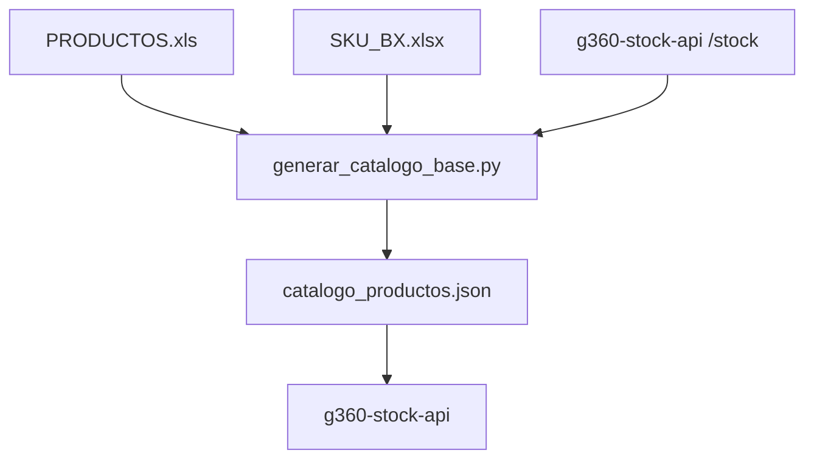

# G360 Master Data

> Sistema centralizado de datos maestros para proyectos G360.
> Genera JSON de catálogo completo desde ERP + SKU_BX + universo de stock.

[]()
[]()
[]()



---

## Estructura

```
g360-master-data/
├── data/
│   ├── PRODUCTOS.xls           ← Fuente principal (mensual/bimestral)
│   │   Columnas: CODIGO, NOMBRE, COD_EAN, COD_EAN_14, CAN_KG_UM,
│   │              LINEA, GRUPO, TIPO, FAMILIA, FLG_INACTIVO,
│   │              FLG_DESCONTINUADO, PRECIO
│   └── SKU_BX.xlsx             ← Guía primaria: qué se vende (manual, agregar cuando ingresa nuevo stock)
│       Columnas: ORDEN, SKU, UN_BX, ESTADO_LINEA
│
├── output/
│   └── catalogo_productos.json ← Catálogo generado (2.759 SKUs)
│
├── scripts/
│   ├── generar_catalogo_base.py ← Genera catálogo desde ERP + SKU_BX + stock (principal, v3.5)
│   ├── generar_catalogo.py     ← Generador legacy v1 (no usar: no lee el ERP actual)
│   ├── leer_plantilla_precios.py ← Lee plantilla_precios.xlsx (hojas PRODUCTOS/DESCUENTOS/PRECIOS_FIJOS)
│   ├── sanitize_key.py         ← Sanea API_KEY (quita whitespace invisible)
│   ├── simular_actualizacion.py ← Simula el ciclo de actualización de código (SKU nuevo)
│   ├── validar_taxonomia.py     ← Validación cruzada de taxonomía (master-data ↔ stock-api)
│   ├── ver_estado.py           ← Muestra estado del catálogo generado
│   └── tests/                   ← Tests unitarios (pytest)
│
├── actualizar_catalogo.bat     ← Workflow interactivo + modo automático (--auto)
└── README.md
```

---

## Flujo de datos

```
1. Descargar PRODUCTOS.xls desde appweb.cipsa.com.pe (mensual/bimestral)
2. Actualizar SKU_BX.xlsx con nuevos SKUs (manual, cuando ingresa stock nuevo)
3. Ejecutar: actualizar_catalogo.bat → Opción 1 (o `actualizar_catalogo.bat --auto` para generar + subir sin preguntar)
4. Verificar output/catalogo_productos.json (opción 2 del bat)
5. Subir al API: Opción s en el bat (requiere `API_KEY` definida), o manualmente:
   curl -X POST "https://g360-stock-api.onrender.com/api/v1/catalog/upload" \
        -H "X-API-Key: %API_KEY%" \
        -F "archivo=@output/catalogo_productos.json"
```

> El `copy` a `..\g360-stock-api\data\catalog_cache.json` solo actualiza el entorno
> local de desarrollo. Producción (Render) **solo** se actualiza vía `POST /api/v1/catalog/upload`
> o vía auto-carga desde GitHub (`catalogo_raw_url`, TTL 6h).
> Definir la clave en la misma terminal antes de ejecutar:
> `set API_KEY=tu_clave` (cmd) o `$env:API_KEY="tu_clave"` (PowerShell).

### El universo de stock (no es opcional)

El catálogo no sale solo del ERP + SKU_BX: incluye además los SKUs que **tienen
stock físico** (hay despacho que hacer y sin catálogo no se conocen peso, EAN ni
caja). Ese universo se consulta en el mismo API de stock que recibe el catálogo.

Si el universo no entra, el catálogo sale **incompleto y en silencio**: en la
última corrida sin universo se perdieron **212 SKUs** que sí tienen stock.

| Variable | Default | Para qué |
|----------|---------|----------|
| `API_KEY` | — | Clave del API. Se usa para el upload **y** para leer el universo (el API acepta la misma clave para ambas cosas) |
| `API_URL` | `https://g360-stock-api.onrender.com` | URL del API |
| `G360_STOCK_URL` | = `API_URL` | URL para leer el universo de stock |
| `G360_STOCK_API_KEY` | = `API_KEY` | Clave de lectura del universo |

El BAT define `G360_STOCK_URL` y `G360_STOCK_API_KEY` a partir de `API_KEY`, y
**pide la clave antes de generar** (en modo interactivo). En modo `--auto` sin
`API_KEY` aborta: no deja generar un catálogo a medias.

Para generar sin universo (a propósito): `python scripts/generar_catalogo_base.py --sin-universo-stock`.

---

## Filtros aplicados

| Filtro | Resultado |
|--------|-----------|
| Inactivos (FLG_INACTIVO) | Excluidos (siempre) |
| Sin precio (≤0) | Excluidos (siempre, incluso los Crayola) |
| Descontinuado fuera de BX y sin stock | Excluido |
| Descontinuado en BX o con stock físico | **Incluido con `descontinuado: true`** |
| Líneas de proceso | Excluidas (siempre) |
| SKUs duplicados en ERP | Solo el primero |
| SKUs en BX sin ERP | Advertencia y se omiten (ej. `04058`) |
| **Productos finales** | **2.759 SKUs** |

Un SKU **vigente** con precio > 0 entra siempre, esté o no en SKU_BX. SKU_BX
manda sobre los *descontinuados* (y aporta `un_bx`, `orden` y `estado_linea`).

### Trazabilidad

El `metadata` del JSON registra por qué se quedó fuera cada fila del ERP y si
el universo de stock entró en la generación:

```json
"exclusiones": { "sin_precio": 9305, "descontinuado_sin_bx_ni_stock": 170, "linea_proceso": 2 },
"universo_stock": { "incluido": true, "skus": 2269, "error": "" }
```

El generador además avisa en consola cuando el catálogo **se achica** respecto
del anterior (suele ser una fuente faltante, no menos productos).

---

## Datos generados

| Campo | Fuente | Notas |
|-------|--------|-------|
| sku, nombre | PRODUCTOS.xls | |
| ean13 | PRODUCTOS.xls | ~45% tiene valor |
| ean14 | PRODUCTOS.xls | ~36% tiene valor |
| peso_kg | PRODUCTOS.xls | |
| linea, grupo, tipo, familia | PRODUCTOS.xls | `linea` es el **código canónico** (2 chars); el nombre va en `linea_nombre` |
| linea_codigo | Mapa estático + desambiguación por grupo | SKUs Crayola (`C*`) usan su prefijo como línea propia (CA/CB/CC/CD/CE/CF → REPRESENTADAS); líneas ERP genéricas (72/76/77/79) quedan 100% VINIFAN. Grupo desempata cuando el nombre es ambiguo (`ACCESORIOS|PINCELES`→`CD`) |
| categoria | Derivada de linea | VINIBALL, VINIFAN, REPRESENTADAS, INDUMENTARIA, PUBLICIDAD, INDUSTRIAL, CIPTECH, MATERIALES, DESCARTE Y VARIOS, PRODUCCION, OTROS |
| un_bx | SKU_BX.xlsx | 37% tiene valor definido (1 por default) |
| orden | SKU_BX.xlsx (col A) | Índice maestro — orden ascendente |
| estado_linea | SKU_BX.xlsx (col D) | NACIONAL, IMPORTADO, NUEVO, TRADICIONAL |
| precio | PRODUCTOS.xls | |
| descontinuado | PRODUCTOS.xls (FLG_DESCONTINUADO) + SKU_BX + stock | `true` si está descontinuado y entra al catálogo; el API lo propaga como badge |
| nombre_corto | Generado con regex | Elimina prefijos, marcas |
| keywords | Generado automáticamente | Palabras clave del nombre + categoría |

> La taxonomía es **compartida** con `g360-stock-api` (`app/core/constants.py`).
> Ambos repos se validan cruzadamente con `scripts/validar_taxonomia.py`: si
> divergen, /stock y /catalog clasifican el mismo SKU en categorías distintas.

---

## Scripts

### `generar_catalogo_base.py`

Genera el catálogo completo desde las tres fuentes.

```bash
# Uso básico
python scripts/generar_catalogo_base.py

# Con argumentos
python scripts/generar_catalogo_base.py -i data/PRODUCTOS.xls -u data/SKU_BX.xlsx -o output/catalogo_productos.json

# Solo validación (no genera output)
python scripts/generar_catalogo_base.py --validate-only

# Sin universo de stock (genera un catálogo incompleto, a propósito)
python scripts/generar_catalogo_base.py --sin-universo-stock
```

### `actualizar_catalogo.bat`

Workflow interactivo + modo automático:

```
1) Generar catalogo base (PRODUCTOS.xls + SKU_BX + universo de stock)
2) Ver estado del catalogo
0) Salir
```

```bat
:: Interactivo (menu)
actualizar_catalogo.bat

:: Automatico: genera + sube al API sin preguntar (requiere API_KEY)
actualizar_catalogo.bat --auto

:: Automatico local: genera + copia local, sin subir
actualizar_catalogo.bat --auto-local

:: Subir JSON existente sin regenerar (requiere API_KEY)
actualizar_catalogo.bat --upload
```

El upload reintenta 3 veces (cold start de Render free-tier) y requiere
`X-API-Key` (variable `API_KEY` en la terminal). En modo interactivo, si
falta la clave el BAT la pide por pantalla; los valores degenerados
(<4 caracteres) se rechazan al instante sin consumir reintentos.

Para persistirla (una sola vez, `cmd` — ojo: `setx` va SIN `=`):
```bat
set API_KEY=tu_clave
setx API_KEY tu_clave
```

### `validar_taxonomia.py`

Validación cruzada: taxonomía del catálogo, líneas Crayola, líneas mixtas,
líneas sin código, claves duplicadas en la taxonomía, precios en cero y
**divergencia con `g360-stock-api`**.

```bash
python scripts/validar_taxonomia.py
python scripts/validar_taxonomia.py --catalogo output/catalogo_productos.json
```

Sale con código 1 si encuentra alertas. El mismo chequeo corre en los tests.

### `simular_actualizacion.py`

Simula el ciclo de actualización de código (SKU nuevo) de punta a punta:
arma un reporte ERP simulado (.xls) y una guía SKU_BX simulada (.xlsx), corre
el generador real y verifica los resultados. Con `--api-url`/`--api-key`
sube el catálogo simulado a un API de stock y comprueba que el SKU nuevo quede
disponible en `/stock`.

```bash
python scripts/simular_actualizacion.py
python scripts/simular_actualizacion.py --api-url http://127.0.0.1:8099 --api-key CLAVE
```

### Tests

```bash
python -m pytest scripts/tests -q
```

---

## Output JSON

```json
{
  "metadata": {
    "version": "3.5.0",
    "generated_at": "2026-10-21T17:27:54.508668",
    "source_erp": "PRODUCTOS.xls",
    "source_un_bx": "SKU_BX.xlsx",
    "total_productos": 2759,
    "estadisticas": {
      "sin_ean13": 1512,
      "con_ean14": 1009,
      "sin_unbx": 1737,
      "con_unbx": 1022,
      "descontinuados": 342,
      "sin_linea_codigo": 0,
      "por_categoria": {
        "VINIFAN": 944,
        "REPRESENTADAS": 828,
        "VINIBALL": 584,
        "PUBLICIDAD": 216,
        "INDUSTRIAL": 106,
        "OTROS": 50,
        "MATERIALES": 31
      },
      "por_linea": { "85": 775, "01": 531, "78": 391, "80": 212, "76": 196 },
      "por_estado_linea": {
        "NUEVO": 406,
        "IMPORTADO": 285,
        "TRADICIONAL": 191,
        "NACIONAL": 140
      }
    },
    "categorias_por_linea": { "01": "VINIBALL", "78": "VINIFAN", "CA": "REPRESENTADAS", "...": "..." },
    "lineas_nombre_a_codigo": { "PELOTAS": "01", "ARCHIVO": "78", "MANUALIDADES": "CE", "...": "..." },
    "lineas_grupo_a_codigo": { "ACCESORIOS|PINCELES": "CD" },
    "exclusiones": { "sin_precio": 9305, "descontinuado_sin_bx_ni_stock": 170, "linea_proceso": 2 },
    "universo_stock": { "incluido": true, "skus": 2269, "error": "" }
  },
  "productos": [
    {
      "sku": "011019",
      "nombre": "N SEMIDEPORTIVA FUTBOL CRACKCITO BLANCO C/ROJO",
      "nombre_corto": "Semideportiva Futbol Crackcito Blanco C/Rojo",
      "ean13": "7754807110198",
      "ean14": "",
      "categoria": "VINIBALL",
      "linea": "01",
      "linea_nombre": "PELOTAS",
      "grupo": "NACIONAL",
      "tipo": "SEMI-DEPORTIVA",
      "familia": "FUTBOL",
      "un_bx": 60,
      "orden": 79,
      "estado_linea": "NACIONAL",
      "peso_kg": 0.20,
      "precio": 9.16,
      "descontinuado": false,
      "linea_codigo": "01",
      "keywords": ["01", "BLANCO", "C/ROJO", "CRACKCITO", "FUTBOL", "PELOTAS", "SEMIDEPORTIVA", "VINIBALL"]
    }
  ]
}
```

---

## Integración con API

El endpoint `/api/v1/catalog/upload` recibe el JSON y lo cachea en memoria (TTL 6h).
Las operaciones de catálogo requieren el header administrativo `X-API-Key`.
Los items de stock siempre se sirven enriquecidos y requieren la clave de lectura
`X-API-Key` configurada para el cliente.

```bash
# Verificar estado del catálogo cargado
curl -H "X-API-Key: $API_KEY" \
     "https://g360-stock-api.onrender.com/api/v1/catalog/health"

# Subir catálogo
curl -X POST "https://g360-stock-api.onrender.com/api/v1/catalog/upload" \
     -H "X-API-Key: $API_KEY" \
     -F "archivo=@output/catalogo_productos.json"
```

> `catalog_raw_url` apunta al raw de GitHub de este repo: un `push` a `main`
> actualiza producción solo (tras el TTL de 6 h). El `POST` es inmediato.

---

## Dependency

```
python>=3.11
openpyxl>=3.1.0
xlrd>=2.0.0
requests>=2.31.0      # lectura del universo de stock
pytest>=8.0.0         # tests
xlwt>=1.3.0           # solo para simular_actualizacion.py (reportes .xls)
```

---

## Familia G360

- **[g360-cli](https://github.com/carloscus/g360-cli)**: Bootstrap de proyectos
- **[g360-stock-api](../g360-stock-api/)**: API de stock con cache y enrich
- **[g360-stock-reporter-lit](../g360-stock-reporter-lit/)**: Frontend PWA

---
**Marca**: G360 · **Autor**: Carlos Cusi
