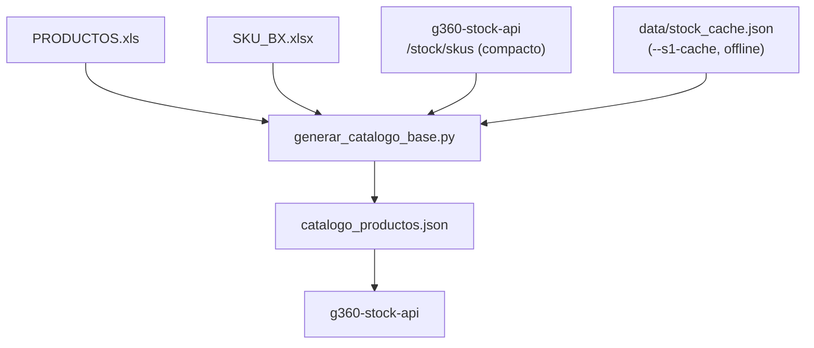

# G360 Master Data

> Sistema centralizado de datos maestros para proyectos G360.
> Genera JSON de catálogo completo desde ERP + SKU_BX + universo de stock.

[]()
[]()
[]()



> **El catálogo es el allowlist del API.** Todo SKU que puede aparecer en
> `/stock` y cotizarse tiene que estar publicado acá: si no está, el API lo
> muestra como `sin_catalogo` (sin precio, sin peso, sin caja).
>
> **Contrato de salida para consumidores** (`g360-stock-api` y apps): la
> definición canónica está en [Versionado del contrato](#versionado-del-contrato-semver)
> (`contract_version`, estabilidad y deprecación) y en [Output JSON](#output-json)
> (ejemplo alineado con el artefacto publicado). Reglas que no se negocian:
> `sku` siempre es texto (los ceros a la izquierda son datos),
> `cobertura_faltante` debe ser `[]` y `data/catalogo.db` es una copia derivada
> del JSON, nunca una segunda fuente de verdad.

---

## Estructura

```
g360-master-data/
├── data/                       ← MATERIA PRIMA LOCAL (exports manuales, NO se versiona)
│   ├── PRODUCTOS.xls           ← Maestro del ERP (mensual/bimestral)
│   │   Columnas: CODIGO, NOMBRE, COD_EAN, COD_EAN_14, CAN_KG_UM,
│   │              LINEA, GRUPO, TIPO, FAMILIA, FLG_INACTIVO,
│   │              FLG_DESCONTINUADO, PRECIO
│   │   Aporta: ficha, EAN, peso, línea, precio y vigencia
│   ├── SKU_BX.xlsx             ← Guía de venta (manual: se agrega al ingresar stock)
│   │   Columnas: ORDEN, SKU, UN_BX, ESTADO_LINEA
│   │             + LARGO_CM, ANCHO_CM, ALTO_CM, PESO_CAJA_KG
│   │             + M3_CAJA, M3_UNIDAD (calculadas, opcionales)
│   │   Aporta: qué se vende, unidades por caja, orden comercial y m³
│   ├── KARDEX_BASE.xlsx        ← Padrón de artículos por almacén (export manual, ~95k filas)
│   │   Columnas: colId/colNom de Almacén, Línea, Grupo, Tipo, Familia,
│   │              Artículo (corto y largo), UM (sin cantidades ni fechas)
│   │   Aporta: jerarquía (línea/grupo/tipo/familia por ID de 2 chars),
│   │   UM por SKU (el ERP no la exporta) y nombres de almacén
│   │   observada SKU × almacén (revisión de guía, fase 3: demanda/rotación)
│   └── plantilla_precios.xlsx  ← Plantilla comercial (hoja única SKU_PRECIOS:
│       SKU, DESC1..6, VIGENCIA_DESC, PRECIO_FIJO, VIGENCIA_PRECIO, OBSERVACION)
│       Aporta: descuentos y precios fijos (vía scripts/leer_plantilla_precios.py)
│
├── plantillas/                 ← MOLDES versionados de los archivos manuales
│   ├── SKU_BX.xlsx             ← molde vacío (columnas de caja + fórmulas m³)
│   └── plantilla_precios.xlsx  ← molde vacío (DESC1..6 como fracción)
│
├── output/
│   └── catalogo_productos.json ← Catálogo generado (~3.550 SKUs) — ÚNICA FUENTE
└── data/
    └── catalogo.db               ← SQLite derivado (regenerable, NO se versiona)

├── scripts/
│   ├── contratos.py            ← Contrato de encabezados: campos canónicos + alias
│   ├── generar_catalogo_db.py  ← JSON → SQLite (solo stdlib, sin red, sin Excel, sin API)
│   └── tests/
│       └── test_catalogo_db.py ← Tests de la BD derivada (pytest)
│   ├── validar_encabezados.py  ← Paso 0: valida las fuentes antes de generar
│   ├── generar_catalogo_base.py ← Genera catálogo desde ERP + SKU_BX + stock (principal, v3.8)
│   ├── generar_catalogo.py     ← Generador legacy v1 (no usar: no lee el ERP actual)
│   ├── crear_plantillas.py     ← Genera/migra las plantillas de plantillas/
│   ├── leer_plantilla_precios.py ← Lee plantilla_precios.xlsx (hoja única SKU_PRECIOS; acepta el layout legacy)
│   ├── sanitize_key.py         ← Sanea API_KEY (quita whitespace invisible)
│   ├── consultar_por_taxonomia.py ← Consulta autónoma por jerarquía (KARDEX → JSON)
│   ├── simular_actualizacion.py ← Simula el ciclo de actualización de código (SKU nuevo)
│   ├── validar_taxonomia.py     ← Validación cruzada de taxonomía (master-data ↔ stock-api)
│   ├── ver_estado.py           ← Muestra estado del catálogo generado
│   ├── verificar.ps1           ← UN comando de verificación (bootstrap + tests + lint)
│   └── tests/                   ← Tests unitarios (pytest)
│
├── actualizar_catalogo.bat     ← Workflow interactivo + modo automático (--auto)
├── requirements.txt|.lock     ← Dependencias fijadas (instalación reproducible)
├── ruff.toml                  ← Política de lint (ignores con motivo)
├── conftest.py                ← pytest solo recolecta scripts/tests/
├── g360/ + g360-manifest.json ← Assets G360 (traídos con `g360 bring`)
├── docs/MANUAL.md             ← Manual de operación autónoma (mapa, diagnóstico)
└── README.md
```

`data/` es **la** carpeta de materia prima: cada archivo aporta una parte del
catálogo y se reemplaza completo cuando llega el export nuevo (no se edita a
mano ni se mezcla). **No se versiona**: son exports pesados y cambian seguido;
el repo solo lleva el catálogo generado (`output/`).

Dentro de `data/` vive `catalogo.db`, la **BD derivada** de
`output/catalogo_productos.json` vía `scripts/generar_catalogo_db.py`. Es un
artefacto regenerable: nadie escribe en ella salvo el generador, si difiere del
JSON se regenera (nunca se edita) y nunca se versiona. Es decisión humana que
sea derivada, no central y no segunda fuente de verdad — el contrato de verdad
sigue siendo el JSON.

`plantillas/` es lo único que **sí** se versiona de los archivos manuales: son
moldes vacíos (con encabezados, fórmulas y listas desplegables) que se copian a
`data/` la primera vez y después viven ahí. El generador **nunca** lee de
`plantillas/`: lee de `data/`, igual que con los exports del ERP.

```bat
:: Crear/refrescar los moldes (no toca data/)
python scripts\crear_plantillas.py

:: Copiar a data/ solo lo que no exista todavia (no pisa nada)
python scripts\crear_plantillas.py --instalar

:: Agregar las columnas de caja a un data/SKU_BX.xlsx que ya tiene datos
python scripts\crear_plantillas.py --migrar
```

Hoy el generador consume **PRODUCTOS.xls + SKU_BX.xlsx + KARDEX_BASE.xlsx
(UM, jerarquía y almacenes) + el universo de stock**; `plantilla_precios.xlsx` está para la
siguiente fase (descuentos). Cuando se sume una fuente nueva, se agrega acá,
se declara su contrato en `scripts/contratos.py` y se escribe su lector en
`scripts/`.

---

## Verificación

Un solo comando deja el repo listo y en verde (es el que declara `AGENTS.md`):

```powershell
.\scripts\verificar.ps1
```

- **Primera vez**: crea `.venv` e instala `requirements.txt` (red solo esa vez).
- **Después**: corre 100% offline, sin activar el venv a mano.
- Corre `pytest` (`scripts/tests/`) y `ruff check scripts` (política en `ruff.toml`).
- Con el venv ya activo también vale `pytest` a secas (un `conftest.py` raíz
  acota la recolección a `scripts/tests/`: los `test_*.py` de `g360/` son
  templates de la CLI, no tests de este repo).

Los tests no tocan red ni `data/`: usan archivos temporales y el catálogo
versionado (`output/catalogo_productos.json`). El único skip restante es el
test de taxonomía contra `g360-stock-api` (integración cross-repo: se omite
solo si el repo hermano no está presente).

Variables de entorno: ver `.env.example` (defaults documentados; ninguna es
obligatoria para generar en modo offline con `G360_S1_CACHE`).

### BD derivada (`data/catalogo.db`)
`verificar.ps1` también construye `data/catalogo.db` desde el JSON en `%TEMP%`
y corre `--check` para confirmar que refleja el artefacto (sha256, conteos,
`user_version`, 7 tablas). Si falla, imprime `BD obsoleta o dañada: regenerar`.
El build es offline (solo stdlib) y no toca `output/`.

Aritmética del cruce (`cruce_s1`, `incluido=true`): `ok=2257` (catálogo∩universo),
`sin_catalogo=0` (universo∖catálogo), `sin_s1=1293` (catálogo∖universo), unión=3550.
Los δ=10 SKUs son filtrados upstream (no huecos): el universo S1 trae 2267 crudos
de los cuales 10 no pasan el filtro de taxonomía, quedando 2257 únicos publicados.

Para operar sin ayuda (consultas, diagnóstico de fallos, dónde vive cada
regla): **`docs/MANUAL.md`**.

---

## Flujo de datos

```
1. Descargar PRODUCTOS.xls desde appweb.cipsa.com.pe (mensual/bimestral)
2. Actualizar SKU_BX.xlsx con nuevos SKUs (manual, cuando ingresa stock nuevo)
3. Ejecutar: actualizar_catalogo.bat → Opción 1 (o `actualizar_catalogo.bat --auto` para generar + subir sin preguntar)
4. Verificar output/catalogo_productos.json (opción 2 del bat)
5. Subir al API: Opción s en el bat (requiere `API_KEY` definida), o manualmente:
   curl -X POST "https://g360-stock-api.onrender.com/api/v1/catalog/upload" \
        -H "X-API-Key: %API_KEY%" \
        -F "archivo=@output/catalogo_productos.json"
```

> El `copy` a `..\g360-stock-api\data\catalog_cache.json` solo actualiza el entorno
> local de desarrollo. Producción (Render) **solo** se actualiza vía `POST /api/v1/catalog/upload`
> o vía auto-carga desde GitHub (`catalogo_raw_url`, TTL 6h).
> Definir la clave en la misma terminal antes de ejecutar:
> `set API_KEY=tu_clave` (cmd) o `$env:API_KEY="tu_clave"` (PowerShell).

### Contrato de encabezados (paso 0)

**Regla:** las fuentes se leen por **NOMBRE** de columna, nunca por posición.

Antes cada lector usaba índices fijos (`cell_value(r, 11)`, `row[2]`): si el
export agregaba una columna, el catálogo se generaba igual pero con el precio
en la familia y la línea en el peso. Sin error, sin aviso. Como el catálogo es
el allowlist del API, ese bug se propaga a todo lo que muestra.

El contrato vive en **`scripts/contratos.py`**: cada fuente declara campos
canónicos con sus alias, y los encabezados se comparan normalizados (sin
acentos, sin NBSP/BOM, sin espacios de más, en mayúsculas). Ejemplo:

| Fuente | Campo | Alias aceptados |
|--------|-------|-----------------|
| ERP | `sku` | `CODIGO`, `SKU` |
| ERP | `peso_kg` | `CAN_KG_UM` (sí: el ERP llama "peso" a esa columna), `PESO`, `PESO_KG` |
| ERP | `precio` | `PRECIO`, `PRECIO_LISTA` |
| SKU_BX | `orden` | `ORDEN`, `N`, `N°`, `NRO` |
| SKU_BX | `un_bx` | `UN_BX`, `U_BX`, `U/BOX`, `UNIDADES_POR_CAJA` |
| DESCUENTOS | `desc1` | `DESC1`, `DESC_ADIC01`, `DESC_ADIC1` |
| PRECIOS_FIJOS | `precio_fijo` | `PRECIO_FIJO`, `PRECIO_FINAL`, `PRECIO` |

**Severidad**

| Situación | Efecto |
|-----------|--------|
| Falta una columna **obligatoria** | `ErrorContrato` **fatal**: no se genera catálogo, el mensaje dice qué falta y qué se encontró |
| Columna de más, encabezado duplicado o alias ambiguo | **Aviso** (se usa la primera/prioritaria) |
| El contenido no coincide con el campo (ej. `PRECIO` sin números en el 90% de la muestra) | **Error** en el paso 0: detecta el corrimiento de columnas que el encabezado solo no ve |

El **paso 0 del BAT** es `scripts/validar_encabezados.py`, que valida las cinco
fuentes antes de generar:

```bat
python scripts\validar_encabezados.py
python scripts\validar_encabezados.py --s1-xls ruta\REPT_STOCK_xx_xx_xxxx.xls
python scripts\validar_encabezados.py --json
```

Un error en las fuentes que alimentan el catálogo (ERP, SKU_BX, S1) **frena
todo**. Un problema en las informativas (plantilla de precios, KARDEX,
revisión de guía) se reporta pero no bloquea la publicación. Dos avisos
merecen atención especial porque anticipan sorpresas:

- **ERP viejo**: el paso 0 informa hace cuántos días se exportó y avisa si
  pasa de 60 (el catálogo saldría "válido" pero rancio: altas que no entran,
  precios desactualizados).
- **Universo S1 parcial**: si el API devuelve un reporte cortado con HTTP
  200, la cobertura da OK (se calcula contra ese mismo universo) y nadie lo
  nota. Por eso el generador compara contra la corrida anterior y publica
  `metadata.universo_stock.previo_skus/variacion`: una caída ≥ 15% sale como
  ALERTA en consola, queda registrada en el metadata y el validador la
  convierte en error (bloquea el upload). Si la caída es real (baja masiva),
  se revisa y se publica con `actualizar_catalogo.bat --upload`.
- **Universo sin taxonomía S1**: el generador cuenta cuántos SKUs vienen sin
  línea (`sin_taxonomia_s1`) y muestra la `fecha_descarga`/`cache_expirado`
  que reporta el API. Si ≥ 15% viene sin línea (parseo viejo o cache
  anterior en el API), ALERTA + error del validador: los S1 caen a OTROS y
  los D no se enlazan. Remedio: verificar deploy/refresh del API y
  regenerar (el BAT lo muestra todo).

> **SKU siempre es TEXTO.** `016763` y `16763` son artículos distintos: si la
> celda se guarda como número, los ceros a la izquierda se pierden y el SKU
> deja de coincidir con el ERP. El validador lo reporta como error.

**Revisión de guía (SKU_BX + precios vs ERP + KARDEX).** El paso 0 también
cruza cada SKU manual contra los maestros con coincidencia **exacta** (los
SKU no tienen "similares": o el código está o no está). Si no va a entrar
al catálogo, dice **por qué** — `inactivo` (en ERP pero dado de baja),
`proceso` (línea excluida), `kardex` (existe en KARDEX pero no en ERP:
revisar maestro) o `inexistente` (no está en ningún lado: mal escrito o
código que no existe). Es informativo (no bloquea): el generador ya omite
esos SKUs por regla.

Los SKUs ya revisados se silencian en `config/guia_ignorados.json`
(`{"ignorados": {"04058": "baja definitiva"}}`): la próxima corrida ya no
los muestra. Si el SKU se corrige o se elimina de la guía, la entrada sobra
y se puede borrar. El generador respeta la misma lista en su WARN final.

**UM desde KARDEX.** El ERP no exporta unidad de medida, así que el catálogo
la toma de KARDEX (`colIdUM`): coincidencia exacta primero y, si no hay,
sin prefijo numérico (`01CA001` → `CA001`). No se adivina con códigos
puramente numéricos (`016763` nunca se reduce a `16763`: son artículos
distintos) ni con ambigüedad (dos códigos distintos al mismo SKU se omiten
y se avisan). Verificado: UM 100% consistente por SKU (0 casos con UM
distinta entre filas/almacenes del export). El KARDEX se lee una sola vez
por archivo (caché en `data/.cache_kardex.json`).

**Reporte S1 (sin encabezado real).** El `.xls` del S1 trae 9–12 filas de
preámbulo y una fila de encabezados con celdas combinadas: `ARTICULO` queda en
la columna de la descripción y el **SKU en la columna anterior**. Por eso no se
busca por nombre: se ubica la fila por **anclas**
(`ARTICULO`/`ALMACEN`/`UM`/`STOCK`/`PREDESPACHO`) y se verifica el SKU contra
los datos, con fallback por contenido. Lo implementan los dos lados:

- `scripts/contratos.py` → `detectar_columnas_s1` (validador, falla con mensaje);
- `g360-stock-api/app/core/parsers.py` → `detectar_columnas` (servicio: si no
  encuentra las anclas, cae al layout histórico y deja un `warning`).

### El universo de stock (no es opcional)

El catálogo no sale solo del ERP + SKU_BX: incluye además los SKUs que **tienen
stock físico o compromiso de venta** (hay despacho que hacer y sin catálogo no
se conocen peso, EAN ni caja). Ese universo se consulta en el mismo API de stock
que recibe el catálogo, en el endpoint **compacto** `GET /api/v1/stock/skus`
(consolidado por SKU, sin el desglose por almacén que multiplica el payload).

Si el universo no entra, el catálogo sale **incompleto y en silencio**: en una
corrida sin universo se perdieron **212 SKUs** que sí tenían stock. Para que no
vuelva a pasar, el generador publica la cobertura en el `metadata` y avisa con
`ALERTA` si algún SKU con movimiento quedó fuera.

| Variable | Default | Para qué |
|----------|---------|----------|
| `API_KEY` | — | Clave del API. Se usa para el upload **y** para leer el universo (el API acepta la misma clave para ambas cosas) |
| `API_URL` | `https://g360-stock-api.onrender.com` | URL del API |
| `G360_STOCK_URL` | = `API_URL` | URL para leer el universo de stock |
| `G360_STOCK_API_KEY` | = `API_KEY` | Clave de lectura del universo |
| `G360_S1_CACHE` | — | JSON del reporte S1 (ej. `g360-stock-api/data/stock_cache.json`). Si está, **no consulta el API** |

El BAT define `G360_STOCK_URL` y `G360_STOCK_API_KEY` a partir de `API_KEY`, y
**pide la clave antes de generar** (en modo interactivo). En modo `--auto` sin
`API_KEY` aborta: no deja generar un catálogo a medias. La excepción es
`G360_S1_CACHE`: con el JSON del S1 no hace falta clave ni red para generar
(el upload al API sí la sigue necesitando).

Después de generar, el BAT **valida** el catálogo (`validar_taxonomia.py`) y
**no sube nada** si hay incoherencias: un catálogo con líneas mixtas, taxonomía
divergente del API o cobertura incompleta no llega a producción.

```bash
# Con el API en vivo (default)
python scripts/generar_catalogo_base.py

# Offline: usa el JSON del reporte S1 copiado al repo (sin clave ni red)
python scripts/generar_catalogo_base.py --s1-cache ..\g360-stock-api\data\stock_cache.json

# Sin universo (a propósito: catálogo incompleto, solo para depurar)
python scripts/generar_catalogo_base.py --sin-universo-stock
```

---

## Regla de inclusión (v3.6.0)

Un SKU entra al catálogo si cumple **cualquiera** de estas condiciones:

```
en guía (SKU_BX) ∨ stock > 0 ∨ compromiso > 0 ∨ (vigente ∧ precio > 0)
```

| Filtro | Resultado |
|--------|-----------|
| Inactivos (FLG_INACTIVO) | Excluidos (siempre: el ERP los borra) |
| Líneas de proceso (códigos `70`/`71`) | Excluidas (siempre) |
| `sin_precio_ni_movimiento` | Excluido: ni stock, ni compromiso, ni guía, ni precio |
| `descontinuado_sin_guia_ni_stock` | Excluido: descontinuado y sin nada que despachar |
| Descontinuado en guía o con stock | **Incluido** con `descontinuado: true`, `vigente: false` |
| SKU con stock/compromiso y **sin precio** | **Incluido** con `cotizable: false`, `por_activar: true` |
| SKUs duplicados en ERP | Solo el primero |
| SKUs en guía sin ERP | Advertencia y se omiten (ej. `04058`) |
| **Productos finales** | **3.550 SKUs** |

El precio ya **no decide la presencia**: decide la **cotizabilidad**. Un SKU sin
precio puede estar publicado (hay producto físico), pero se marca `por_activar`
para que comercial lo complete. `cotizable` y `por_activar` son complementarios
exactos (`cotizable = precio > 0`).

### Categorías de venta (el semáforo)

La categoría de negocio sigue saliendo de la línea (con la marca mandando en
Crayola), pero para venta se publica además `categoria_venta`:

| `categoria_venta` | Significado |
|-------------------|-------------|
| `VINIBALL` | Se vende |
| `VINIFAN` | Se vende |
| `REPRESENTADAS` | Se vende (incluye todas las líneas Crayola `CA..CG`) |
| `REVISION_VENTA` | Está en el catálogo (hay producto), pero **no se cotiza** hasta que comercial revise |

`REVISION_VENTA` agrupa MATERIALES, INDUSTRIAL, CIPTECH, PUBLICIDAD,
DESCARTE Y VARIOS, OTROS, etc. La distribución actual: **REVISION_VENTA 1.152 /
VINIFAN 972 / REPRESENTADAS 838 / VINIBALL 576**.

> **`OTROS` (14) ≠ `VARIOS` (99).** No son dos nombres para lo mismo: la
> desambiguación no la hace el nombre de la línea sino la jerarquía validada
> contra KARDEX por línea (grupo + tipo + familia, con calce directo por SKU
> primero y por nombre solo si hay un candidato único; nunca se adivina).
> `14` son 36 SKU de JUGUETES/PROTECTOR FACIAL/ATOMIZADOR → `VINIBALL`,
> con 9 en guía SKU_BX; `99` son 50 SKU de ACTIVO FIJO/SERVICIOS →
> `OTROS` / `REVISION_VENTA`, sin guía. SKU_BX define guía y caja; el nombre
> de línea solo etiqueta.

### SKUs exactos, sin enlaces por parecido (ex método D)

Cada SKU es exacto y standalone: ningún código "parecido" genera vínculo
ni herencia. Un `03077D` no es un `03077` aunque el nombre se parezca: entra
al catálogo con su propia ficha (línea, precio, peso) o no entra.

- La línea 98 (sin embalaje) está fuera del semáforo vendible
  (`REVISION_VENTA`): esos SKUs se ven y se despachan, pero no se cotizan
  hasta tener precio propio (`por_activar`).
- No hay comparación de nombres en ninguna parte del flujo: el único
  parecido que se tolera es la igualdad exacta del código.
- El campo `derivado_de` del JSON se mantiene siempre vacío por
  compatibilidad con el API (que lo ignora).

### Trazabilidad

El `metadata` del JSON registra por qué se quedó fuera cada fila del ERP, si el
universo de stock entró y si hubo SKUs con movimiento que no se publicaron:

> **Trazabilidad operativa actual, no recomendada para nuevas integraciones.**
> Los campos `regla_inclusion`, `exclusiones` y `universo_stock` están
> **DEPRECADOS**: se siguen emitiendo pero su sustituto es `fuentes` (con sha256)
> para trazabilidad de archivo y `metadata` estable para el resto. Ver §
> Versionado del contrato (semver) → Deprecación.

```json
"regla_inclusion": "en guia ∨ stock > 0 ∨ compromiso > 0 ∨ (vigente ∧ precio > 0)",
"exclusiones": {
  "linea_proceso": 6538,
  "sin_precio_ni_movimiento": 2227,
  "descontinuado_sin_guia_ni_stock": 427
},
"universo_stock": { "incluido": true, "skus": 2267, "con_stock": 2267, "con_compromiso": 672, "error": "" },
"universo_skus": ["016763", "..."],
"cobertura_faltante": []
```

`cobertura_faltante` es el invariante: **debe ser `[]`**. Si trae un SKU, ese
producto tiene movimiento y quedó fuera del catálogo (el generador imprime
`ALERTA` y el validador falla). `universo_skus` son los SKUs vendibles del
reporte (excluye líneas de proceso) para que el validador lo verifique sin
releer el S1.

El generador además avisa en consola cuando el catálogo **se achica** respecto
del anterior (suele ser una fuente faltante, no menos productos).

---

## Datos generados

| Campo | Fuente | Notas |
|-------|--------|-------|
| sku, nombre | PRODUCTOS.xls / S1 | | |
| ean13 | PRODUCTOS.xls | ~36% tiene valor |
| ean14 | PRODUCTOS.xls | ~29% tiene valor |
| peso_kg | PRODUCTOS.xls | |
| linea, grupo, tipo, familia | PRODUCTOS.xls / S1 (nombres) | `linea` es el **código canónico** (2 chars); el nombre va en `linea_nombre`. Grupo/tipo/familia salen **sin** el código del S1 (`03 - BORRADOR` → `BORRADOR`) |
| grupo_id, tipo_id, familia_id | KARDEX (IDs de 2 chars) | Los IDs de jerarquía para filtrar sin leer el KARDEX. Sin calce directo se resuelven **por nombre** contra el maestro (verificado por línea, nunca adivinando): ~99.8% de cobertura; lo que queda vacío es que el KARDEX no conoce esa combinación |
| um | KARDEX (primaria) → S1 (fallback) | Cadena: ficha (S1-only) → KARDEX → universo S1. Vacío solo si ninguna fuente lo sabe |
| almacenes | KARDEX | Lista de ids de los almacenes donde el SKU tiene presencia (calce directo con KARDEX). Los nombres se resuelven en `metadata.almacenes.nombres` — una sola copia, sin duplicar en cada SKU. Vacío para SKUs sin calce directo (la resolución por nombre es de jerarquía, no da presencia por SKU) |
| linea_codigo | Mapa estático + desambiguación por grupo | SKUs Crayola (`C*`) usan su prefijo como línea propia (CA/CB/CC/CD/CE/CF/CG → REPRESENTADAS); líneas ERP genéricas (72/76/77/79) quedan 100% VINIFAN. Grupo desempata cuando el nombre es ambiguo (`ACCESORIOS|PINCELES`→`CD`) |
| categoria | Marca > línea | La **marca manda**: todo SKU `C*` es `REPRESENTADAS` con línea propia (su prefijo de 2 letras), aunque la línea del ERP sea genérica o la sub-marca aún no exista en la taxonomía. Para el resto, la categoría sale de la línea |
| categoria_venta | Derivada de `categoria` | `VINIBALL` / `VINIFAN` / `REPRESENTADAS`, o `REVISION_VENTA` para el resto |
| un_bx | SKU_BX.xlsx | 29% tiene valor definido (1 por default) |
| orden | SKU_BX.xlsx (col A) | Índice maestro — orden ascendente |
| estado_linea | SKU_BX.xlsx (col D) | NACIONAL, IMPORTADO, NUEVO, TRADICIONAL |
| precio | PRODUCTOS.xls | |
| descontinuado | PRODUCTOS.xls (FLG_DESCONTINUADO) + SKU_BX + stock | `true` si está descontinuado y entra al catálogo; el API lo propaga como badge |
| en_guia | SKU_BX.xlsx | `true` si el SKU está curado en la guía |
| compromiso | S1 (`predespacho`) | `true` si tenía compromiso de venta al generar |
| cotizable / por_activar | `precio > 0` | Complementarios exactos |
| vigente | ERP | `false` si el ERP lo marca descontinuado |
| derivado_de | Siempre "" | Reservado por compatibilidad con el API; no se enlaza nada por parecido |
| origen | ERP / S1 | `erp` (ficha del maestro) o `s1` (solo existe en el reporte) |
| stock_snapshot / predespacho_snapshot | S1 | Foto del movimiento al generar (trazabilidad, no stock vivo) |
| nombre_corto | Generado con regex | Elimina prefijos, marcas |
| keywords | Generado automáticamente | Palabras clave del nombre + categoría |

> La taxonomía es **compartida** con `g360-stock-api` (`app/core/constants.py`).
> Ambos repos se validan cruzadamente con `scripts/validar_taxonomia.py`: si
> divergen, /stock y /catalog clasifican el mismo SKU en categorías distintas.

---

## Scripts

### `contratos.py`

Núcleo de la convención (ver *Contrato de encabezados*): normalización de
encabezados y valores, `ErrorContrato`, `resolver_columnas` (campo canónico →
índice), los contratos por fuente (`CONTRATO_ERP`, `CONTRATO_SKU_BX`,
`CONTRATO_KARDEX`, `CONTRATO_PLANTILLA_*`), las anclas del S1
(`detectar_columnas_s1`), la lista de almacenes publicados, `calcular_m3` y
`huella_fuente` (sha256 + fecha para la trazabilidad). También el cruce de
SKUs: `emparejar_skus` (exacto primero, prefijo verificado después, en
cualquier dirección), `derecha2`/`reducir_uno_numerico` (reglas por columna)
e `indice_jerarquia_por_nombre`/`resolver_jerarquia_por_nombre` (IDs por
nombre verificados por línea). `leer_kardex` es la única lectura del padrón
(con caché en `data/.cache_kardex.json`). No lee archivos por sí mismo los
contratos: lo usan todos los lectores.

### `validar_encabezados.py`

Paso 0 del workflow. Valida ERP, SKU_BX, plantilla de precios, S1 (si hay un
`.xls` en `data/`) y KARDEX: columnas obligatorias por nombre, **sanidad del
contenido** (un SKU parece SKU, un precio es número, UN_BX entero, descuentos
en rango), duplicados, columnas de más, SKUs guardados como número y cajas
incompletas. Además cruza la **guía vs maestros** (motivo por SKU, con
`config/guia_ignorados.json` para los ya revisados) y audita **KARDEX vs ERP**
por taxonomía (divergencias de línea/grupo/tipo/familia, conflictos de
almacén, frescura del ERP): los 3 bloques informativos documentan
divergencias entre originales sin frenar nada.

```bash
python scripts/validar_encabezados.py
python scripts/validar_encabezados.py --s1-xls ..\g360-erp-stock-consolidator\samples\REPT_STOCK_22_05_2026.xls
python scripts/validar_encabezados.py --json
```

Sale con código 1 solo si falla una fuente que alimenta el catálogo.

### generar_catalogo_db.py

Deriva `data/catalogo.db` (SQLite, regenerable) desde `output/catalogo_productos.json` sin red ni Excel:

```powershell
python scripts\generar_catalogo_db.py                    # build por defecto (output/ -> data/)
python scripts\generar_catalogo_db.py --check            # verifica sin escribir; exit 1 si obsoleta/dañada
python scripts\generar_catalogo_db.py --json x.json --db y.db --quiet
```

- Flags: `--json` (default `output/catalogo_productos.json`), `--db` (default `data/catalogo.db`), `--check`, `--quiet`.
- Códigos de salida: 0 ok · 1 BD obsoleta/dañada (`--check`) · 2 JSON ausente/ilegible · 3 contrato roto · 4 invariante.
- `--check` valida en orden: BD válida, `json_sha256`+`json_bytes`, `PRAGMA user_version=1`, 7 tablas, `COUNT(producto)==total_productos`, y `s1_universo`/`cruce_s1` según `incluido`. Falla con `BD obsoleta o dañada: regenerar`.
- El build es offline (solo stdlib), escribe en `<db>.tmp` y hace `os.replace()` atómico; `<db>.tmp` se borra al inicio y en `finally`.
- `incluido=false` es condición del JSON: build permitido con warning en stderr, `s1_universo`/`cruce_s1` vacías, exit 0.

### `generar_catalogo_base.py`

Genera el catálogo completo desde las tres fuentes.

```bash
# Uso básico (API en vivo, requiere G360_STOCK_API_KEY o API_KEY)
python scripts/generar_catalogo_base.py

# Con argumentos
python scripts/generar_catalogo_base.py -i data/PRODUCTOS.xls -u data/SKU_BX.xlsx -o output/catalogo_productos.json

# Offline: universo desde el JSON del reporte S1 copiado al repo
python scripts/generar_catalogo_base.py --s1-cache ..\g360-stock-api\data\stock_cache.json

# Solo validación (no genera output)
python scripts/generar_catalogo_base.py --validate-only

# Sin universo de stock (genera un catálogo incompleto, a propósito)
python scripts/generar_catalogo_base.py --sin-universo-stock
```

| Argumento | Env equivalente | Para qué |
|-----------|-----------------|----------|
| `--erp` / `-e` | — | `PRODUCTOS.xls` |
| `--unbx` / `-u` | — | `SKU_BX.xlsx` |
| `--output` / `-o` | — | JSON de salida |
| `--stock-url` | `G360_STOCK_URL` | API para leer el universo (`/stock/skus`) |
| `--stock-key` | `G360_STOCK_API_KEY` | Clave de lectura |
| `--s1-cache` | `G360_S1_CACHE` | JSON local del S1: no consulta el API |
| `--sin-universo-stock` | — | Genera solo con ERP + guía (incompleto) |
| `--validate-only` / `-v` | — | Valida sin escribir |

### `actualizar_catalogo.bat`

Workflow interactivo + modo automático:

```
0) Validar encabezados de las fuentes (contrato)
1) Generar catalogo base (PRODUCTOS.xls + SKU_BX + universo de stock)
2) Ver estado del catalogo
0) Salir
```

> El paso 0 corre **siempre**, antes de generar. Si una fuente cambió de
> formato, el BAT corta ahí con el mensaje del contrato: no hay forma de
> generar un catálogo con las columnas corridas.

```bat
:: Interactivo (menu)
actualizar_catalogo.bat

:: Automatico: genera + sube al API sin preguntar (requiere API_KEY)
actualizar_catalogo.bat --auto

:: Automatico local: genera + copia local, sin subir
actualizar_catalogo.bat --auto-local

:: Offline: universo desde el JSON del S1 (no consulta el API)
set G360_S1_CACHE=..\g360-stock-api\data\stock_cache.json
actualizar_catalogo.bat --auto-local

:: Subir JSON existente sin regenerar (requiere API_KEY)
actualizar_catalogo.bat --upload
```

Con `G360_S1_CACHE` definido, el BAT **no pide clave para generar** (el upload
sigue necesitándola). Es el modo recomendado cuando el reporte S1 se copia al
repo a mano, sin depender de que el API esté arriba.

El upload reintenta 3 veces (cold start de Render free-tier) y requiere
`X-API-Key` (variable `API_KEY` en la terminal). En modo interactivo, si
falta la clave el BAT la pide por pantalla; los valores degenerados
(<4 caracteres) se rechazan al instante sin consumir reintentos.

Para persistirla (una sola vez, `cmd` — ojo: `setx` va SIN `=`):
```bat
set API_KEY=tu_clave
setx API_KEY tu_clave
```

### Plantillas manuales (`crear_plantillas.py`)

Los archivos que se llenan a mano (`SKU_BX.xlsx`, `plantilla_precios.xlsx`)
tienen un molde versionado en `plantillas/`. El molde trae lo que un Excel a
mano no garantiza:

- **SKU como TEXTO** (no se comen los ceros a la izquierda);
- `ESTADO_LINEA` con lista desplegable;
- **m³ calculado** con fórmulas (`M3_CAJA = largo*ancho*alto/1.000.000`,
  `M3_UNIDAD = M3_CAJA/UN_BX`);
- descuentos como **fracción** validada (0 ≤ x < 1: `10% = 0.10`);
- una hoja `LEEME` con las reglas de cada columna.

```bash
# Crear/refrescar los moldes (plantillas/)
python scripts/crear_plantillas.py

# Instalar en data/ solo si el archivo no existe (nunca pisa datos)
python scripts/crear_plantillas.py --instalar

# Migrar un data/SKU_BX.xlsx que ya tiene datos: agrega las columnas de caja
# al final y las fórmulas en las filas existentes (hace backup .bak.xlsx)
python scripts/crear_plantillas.py --migrar
```

Flujo: se copia el molde a `data/`, se llena ahí y se sigue editando ahí. El
generador lee **siempre** de `data/`.

### `leer_plantilla_precios.py`

Lee `plantilla_precios.xlsx` y genera `precios_productos.json`.

```bash
python scripts/leer_plantilla_precios.py -i data/plantilla_precios.xlsx
python scripts/leer_plantilla_precios.py -i ... --sku-bx data/SKU_BX.xlsx
python scripts/leer_plantilla_precios.py -i ... --catalogo output/catalogo_productos.json
```

v2.0: lee por nombre de columna (acepta `DESC1..6` y `DESC_ADIC01..06`), la
hoja `PRODUCTOS` dejó de ser obligatoria (el orden vive en `SKU_BX`), y los
descuentos se publican como fracción. Con `--catalogo` filtra a los SKUs
publicados; con `--sku-bx` copia el orden maestro.

### `validar_taxonomia.py`

Validación cruzada: taxonomía del catálogo, líneas Crayola, líneas mixtas,
líneas sin código, **coherencia de precio y flags** (`cotizable`/`por_activar`/
`compromiso`/`categoria_venta`), **cobertura del universo**
(`cobertura_faltante` vacío + cross-check de `universo_skus`), **alertas de
universo** (`alerta_caida`, `alerta_sin_taxonomia`) y **divergencia con
`g360-stock-api`**.

```bash
python scripts/validar_taxonomia.py
python scripts/validar_taxonomia.py --catalogo output/catalogo_productos.json
```

Devuelve **errores** (bloquean la subida al API) y **avisos** (mantenimiento
pendiente, no bloquean). El BAT la ejecuta después de generar: si hay errores,
**no sube el catálogo**.

> Un catálogo generado sin universo de stock es un **error**, no un aviso:
> pierde los SKUs con despacho que no están en SKU_BX (212 en la última
> corrida). Si el API de stock no responde, reintenta 3 veces y, si sigue
> caído, regenera antes de subir.

### Sub-marca Crayola nueva

Si aparece una sub-marca nueva (CH, CI…), el generador:

1. la **publica ya clasificada** como `REPRESENTADAS` en la taxonomía del
   metadata (así ningún consumidor la deja en el default `OTROS`);
2. avisa en consola y el validador lo reporta como aviso (no bloquea).

Para dejarla fija, completar este checklist:

1. `scripts/generar_catalogo_base.py`: agregar `"CH": "REPRESENTADAS"` a `CATEGORIA_POR_LINEA` (y a `LINEA_NOMBRE_A_CODIGO` si el nombre de línea es nuevo).
2. `g360-stock-api/app/core/constants.py`: agregar `"CH"` a la lista `CATEGORIAS["REPRESENTADAS"]`.
3. Validar con el checkout hermano presente: `python scripts/validar_taxonomia.py` (si el test cross-repo se salta, el hermano no está en la ruta esperada — ver `scripts/tests/test_validacion_taxonomia.py:171`).
4. Regenerar y subir el catálogo con `actualizar_catalogo.bat`.

> Nota: el catálogo ya publica `metadata.categorias_por_linea` y stock-api lo expone; la copia en `constants.py` es deuda por eliminar, no la fuente de verdad. El generador ya publica sub-marcas nuevas clasificadas automáticamente como `REPRESENTADAS`, así que esta alta es para **fijarlas**, no para que funcionen.

Mientras no se fije, el API de stock sigue clasificando bien los C* por marca
(todo C* es REPRESENTADAS, incluso sin catálogo).

### `simular_actualizacion.py`

Simula el ciclo de actualización de código (SKU nuevo) de punta a punta:
arma un reporte ERP simulado (.xls) y una guía SKU_BX simulada (.xlsx), corre
el generador real y verifica los resultados. Con `--api-url`/`--api-key`
sube el catálogo simulado a un API de stock y comprueba que el SKU nuevo quede
disponible en `/stock`.

```bash
python scripts/simular_actualizacion.py
python scripts/simular_actualizacion.py --api-url http://127.0.0.1:8099 --api-key CLAVE
```

### `consultar_por_taxonomia.py`

Consulta autónoma por jerarquía sin ayuda de nadie: filtra el KARDEX por
`--linea/--grupo/--tipo/--familia` (IDs exactos, **entrecomillar las comas en
PowerShell**: `--familia '01,02'`), cruza contra el JSON publicado (exacto
primero, prefijo verificado después) y muestra EAN13/EAN14, precio, peso,
`un_bx`, stock y categoría — o el motivo `FUERA` de cada SKU.

```bash
python scripts/consultar_por_taxonomia.py --linea 01 --grupo 01 --tipo 02 --familia '01,02'
python scripts/consultar_por_taxonomia.py --linea 01 --json          # salida para otra app
python scripts/consultar_por_taxonomia.py --linea 01 --limite 0      # ver todo
```

La tabla muestra `SKU_KARDEX -> SKU_JSON` cuando difieren (`1011019 -> 011019`).

### Tests

```bash
python -m pytest scripts/tests -q
```

257 tests: generación (inclusión, taxonomía, SKUs exactos sin enlaces,
cobertura, universo S1, IDs de jerarquía y almacenes por SKU), contrato de encabezados (normalización, alias,
duplicados, columnas corridas, anclas del S1, cajas/m³), revisión de guía,
robustez de la validación y BD derivada (32 tests: build, `--check`, sha256, invariantes y regresión).

---
## Versionado del contrato (semver)

El catálogo expone un **contrato de datos** versionado bajo semver. Cada versión
del catálogo es también una versión del contrato:

```
contract_version = VERSION
```

Los consumidores (`g360-stock-api`: `app/config.py:37` y
`app/services/catalog_service.py:41-55`) leen `contract_version` para decidir
si el catálogo publicado es compatible con su versión de código. Por eso el
campo vive en el artefacto (`output/catalogo_productos.json`) y no solo en el
generador.

### Cómo se publica `contract_version`

El campo se publica de dos formas que convergen en el mismo valor:

1. **Generador:** `scripts/generar_catalogo_base.py` lo emite en cada corrida
   (`metadata.contract_version == VERSION`, hoy `3.8.0`).
2. **Script determinista:** `scripts/actualizar_contract_version.py` inserta
   (o corrige) SOLO `metadata.contract_version` en un artefacto ya generado,
   sin tocar ningún otro dato (`generated_at`, `total_productos`, productos,
   estadísticas...). Es idempotente: si el campo ya tiene el valor esperado,
   el archivo queda intacto.

El BAT lo ejecuta como **paso aditivo posterior a la generación completa**
(ver `actualizar_catalogo.bat`, luego de generar el catálogo y antes de
validar/subir). Sirve para publicar el campo en artefactos ya generados sin
tener que regenerar desde cero.

> El orden de claves dentro de `metadata` no es contractual (JSON no lo
> define), pero el script las publica con `contract_version` inmediatamente
> despues de `version` para que el artefacto, el generador y el ejemplo del
> README queden alineados.

### Política semver

| Bump | Dispara |
|------|---------|
| **MAJOR** (4.0.0) | Eliminar/renombrar cualquier campo en **cualquier nivel** (incluye claves dentro de `metadata.almacenes`, `metadata.fuentes` y `estadisticas`); cambiar tipo, nulabilidad o **significado** en cualquier nivel; cambiar `regla_inclusion` de modo que un SKU cambie de incluido/excluido; redefinir la semántica de campos normados (`categoria_venta`, `linea`, `origen`, `stock_snapshot`, `predespacho_snapshot`, `derivado_de`); quitar un valor de una enumeración. |
| **MINOR** (3.9.0) | Agregar campo aditivo o clave nueva a un mapa **si está documentado que los consumidores deben tolerar claves/valores desconocidos con fallback**; agregar valor a `categorias_venta` **solo bajo esa misma regla de tolerancia**. Si no hay regla de tolerancia documentada para ese mapa/enumeración, el agregado es MAJOR. |
| **PATCH** (3.8.1) | Correcciones que no cambian shape ni semántica. Los **refrescos de contenido no bumpan** la versión (el catálogo se regenera con datos nuevos pero `VERSION` y `contract_version` se mantienen). |

> El catálogo **no es fuente de stock**: los campos de movimiento son diagnóstico de generación, no contenido del catálogo. El dato de stock vivo vive en `/api/v1/stock` de `g360-stock-api` (TTL 10 min) y se valida por SKU.

> **Campos RESERVADOS:** poblar un campo RESERVADO (`dimensiones_caja`, hoy `null` en el 100% de los 3550 SKU) con su tipo y nulabilidad actuales es **refresco de contenido**, no un bump: no cambia nombre, tipo, nulabilidad ni significado del contrato. Sí sería MAJOR convertirlo en obligatorio, cambiar su tipo o redefinir su semántica.

### Alcance de ESTABLE

Estable significa conservar **nombre, tipo, nulabilidad y semántica**; un cambio en cualquiera de esas dimensiones requiere MAJOR.

**Metadato ESTABLE:** `version`, `contract_version`, `generated_at`, `fuentes` (forma interna `archivo`/`bytes`/`sha256`/`modificado` parte del contrato), `total_productos`, `estadisticas.*` (las 22 claves: `sin_ean13`, `con_ean14`, `sin_unbx`, `con_unbx`, `con_caja`, `descontinuados`, `sin_linea_codigo`, `con_linea_otros`, `en_guia`, `con_compromiso`, `por_activar`, `cotizables`, `con_um`, `con_ids_jerarquia`, `ids_por_nombre`, `con_almacenes`, `derivados`, `solo_s1`, `por_categoria`, `por_categoria_venta`, `por_linea`, `por_estado_linea`), `categorias_por_linea`, `categorias_venta`, `categoria_venta_revision`, `almacenes` (forma de `almacenes.almacenes` parte del contrato), `lineas_nombre_a_codigo`, `lineas_grupo_a_codigo`, `universo_skus`, `cobertura_faltante`.

**Metadato DEPRECADO (se sigue emitiendo):** `source_erp`, `source_un_bx`, `source_stock` (sustituto: `fuentes` con sha256), `regla_inclusion`, `exclusiones`, `universo_stock` (diagnóstico de generación: qué filas del ERP quedaron fuera y si entró el universo S1; no es dato del catálogo, sustituto es la validación por SKU en `/api/v1/stock`).

**Producto ESTABLE:** `sku`, `nombre`, `nombre_corto`, `ean13/14`, `peso_kg`, `linea`, `linea_nombre`, `grupo/tipo/familia` + `_id`, `um`, `almacenes`, `un_bx`, `orden`, `estado_linea`, `precio`, `descontinuado`, `en_guia`, `cotizable`, `por_activar`, `vigente`, `categoria`, `categoria_venta`, `origen`, `keywords`, `linea_codigo`, `derivado_de` (clave estable, hoy siempre vacía por compatibilidad; su contenido placeholder puede evolucionar dentro de su tipo), `derivados` (clave de estadísticas, siempre 0).

**Producto DEPRECADO/RESERVADO:** `dimensiones_caja` (RESERVADO: se emite por herencia, no recomendado para nuevas integraciones; sin sustituto; validador local en `scripts/validar_taxonomia.py:327-341` y tests en `test_contratos.py:748,778`). No se elimina. `stock_snapshot`, `predespacho_snapshot` y `compromiso` (DEPRECADO: diagnóstico de la corrida de generación, no dato del catálogo; se siguen emitiendo por compatibilidad hasta el próximo MAJOR; sustituto es `/api/v1/stock` de `g360-stock-api` consultado por SKU).

### Deprecación

Cada campo DEPRECADO/RESERVADO se sigue emitiendo hasta al menos el MAJOR siguiente (4.0.0). Su eliminación efectiva es cambio de nivel C que requiere aprobación humana. Ninguno se elimina en esta versión.

### Aclaración acotada sobre v3.6.0 → 3.8.0

Los flags de negocio y la regla de inclusión se introdujeron en **v3.6.0**; el contrato vigente es **3.8.0**. Las menciones "(v3.6.0)" en títulos/docstrings de flags/reglas son **atribución histórica** de esa funcionalidad. No se generaliza a toda mención textual de 3.6.0: hay lógica de compatibilidad en `scripts/validar_taxonomia.py:232` y un endpoint v3.6.0 en `scripts/generar_catalogo_base.py:1530`.

**Promesa de estabilidad:** nada se elimina sin MAJOR + ciclo de deprecación.

## Output JSON

> **Ejemplo coherente con el artefacto real** (`output/catalogo_productos.json`,
> ya publicado con `metadata.contract_version = "3.8.0"` vía el script
> determinista). Los campos `source_erp`, `source_un_bx`, `source_stock`,
> `regla_inclusion`, `exclusiones` y `universo_stock` están **DEPRECADOS**:
> se siguen emitiendo pero no se recomiendan para nuevas integraciones;
> su sustituto es `fuentes` (con sha256) para trazabilidad de archivo.
> Ver § Versionado del contrato (semver) → Deprecación.

```json
{
  "metadata": {
    "version": "3.8.0",
    "contract_version": "3.8.0",
    "generated_at": "2026-10-26T09:47:24.067439",
    "source_erp": "PRODUCTOS.xls",
    "source_un_bx": "SKU_BX.xlsx",
    "source_stock": "http://appweb.cipsa.com.pe:8054/...",
    "fuentes": [
      { "archivo": "PRODUCTOS.xls", "bytes": 4844312, "sha256": "2dbbbf8b9669cc52", "modificado": "2026-10-20T16:16:53" },
      { "archivo": "SKU_BX.xlsx", "bytes": 37266, "sha256": "e910d11c282f85b0", "modificado": "2026-09-21T23:37:32" }
    ],
    "total_productos": 3550,
    "estadisticas": {
      "sin_ean13": 2295,
      "con_ean14": 1017,
      "sin_unbx": 2528,
      "con_unbx": 1022,
      "con_caja": 0,
      "descontinuados": 363,
      "sin_linea_codigo": 0,
      "con_linea_otros": 0,
      "con_um": 3549,
      "con_ids_jerarquia": 3544,
      "ids_por_nombre": 39,
      "con_almacenes": 3505,
      "en_guia": 1022,
      "con_compromiso": 672,
      "por_activar": 791,
      "cotizables": 2759,
      "derivados": 0,
      "solo_s1": 506,
      "por_categoria_venta": {
        "REVISION_VENTA": 1175,
        "VINIFAN": 948,
        "REPRESENTADAS": 838,
        "VINIBALL": 589
      },
      "por_categoria": { "VINIFAN": 948, "REPRESENTADAS": 838, "VINIBALL": 589, "INDUSTRIAL": 447 },
      "por_linea": { "85": 776, "01": 536, "78": 394, "80": 310, "...": "..." },
      "por_estado_linea": { "NUEVO": 406, "IMPORTADO": 285, "TRADICIONAL": 191, "NACIONAL": 140 }
    },
    "categorias_por_linea": { "01": "VINIBALL", "78": "VINIFAN", "CA": "REPRESENTADAS", "...": "..." },
    "categorias_venta": ["VINIBALL", "VINIFAN", "REPRESENTADAS"],
    "categoria_venta_revision": "REVISION_VENTA",
    "regla_inclusion": "en guia ∨ stock > 0 ∨ compromiso > 0 ∨ (vigente ∧ precio > 0)",
    "lineas_nombre_a_codigo": { "PELOTAS": "01", "ARCHIVO": "78", "MANUALIDADES": "CE", "...": "..." },
    "lineas_grupo_a_codigo": { "ACCESORIOS|PINCELES": "CD" },
    "exclusiones": {
      "linea_proceso": 6538,
      "sin_precio_ni_movimiento": 2236,
      "descontinuado_sin_guia_ni_stock": 446
    },
    "universo_stock": { "incluido": true, "skus": 2267, "con_stock": 2267, "con_compromiso": 672, "error": "", "previo_skus": 2267, "variacion": 0.0 },
    "universo_skus": ["016763", "..."],
    "cobertura_faltante": [],
    "almacenes": {
      "principal": "VES",
      "almacenes": { "40": "venta", "VES": "venta", "...": "..." },
      "nombres": { "40": "ALMACEN PROD. TERMINADOS", "VES": "CENTRO LOGISTICO VES", "...": "..." },
      "fuente": "config"
    },
  },
  "productos": [
    {
      "sku": "016763",
      "nombre": "FUTBOL PU FUTURE #5",
      "nombre_corto": "Futbol Future #5",
      "ean13": "",
      "ean14": "",
      "categoria": "VINIBALL",
      "categoria_venta": "VINIBALL",
      "linea": "01",
      "linea_nombre": "PELOTAS",
      "grupo": "IMPORTADA VINIBALL",
      "grupo_id": "01",
      "tipo": "PU",
      "tipo_id": "02",
      "familia": "FUTBOL",
      "familia_id": "01",
      "um": "UND",
      "almacenes": ["40", "92", "121", "VES", "..."],
      "un_bx": 18,
      "orden": 1,
      "estado_linea": "IMPORTADO",
      "peso_kg": 0.4,
      "dimensiones_caja": {
        "largo_cm": 40,
        "ancho_cm": 30,
        "alto_cm": 25,
        "m3_caja": 0.03,
        "m3_unidad": 0.001667,
        "peso_caja_kg": null
      },
      "precio": 70.0,
      "descontinuado": false,
      "linea_codigo": "01",
      "en_guia": true,
      "compromiso": true,
      "cotizable": true,
      "vigente": true,
      "por_activar": false,
      "derivado_de": "",
      "origen": "erp",
      "stock_snapshot": 621,
      "predespacho_snapshot": 229,
      "keywords": ["01", "FUTBOL", "FUTURE", "PELOTAS", "VINIBALL"]
    }
  ]
}
```

`dimensiones_caja` es el tamaño **físico** de la caja (largo/ancho/alto en cm,
m³ de la caja y m³ por unidad); `un_bx` es **cuántas unidades entran**. Van en
campos separados a propósito: el API ya usa `caja` para las unidades. Si falta
largo, ancho o alto, `dimensiones_caja` es `null`: no se inventa volumen.
`m3_caja` se **calcula en el generador** (no se confía en la fórmula de Excel:
una celda pegada como valor no se recalcula nunca).

`metadata.fuentes` deja la huella (sha256 corto, tamaño y fecha) de los
archivos que se leyeron: el catálogo es trazable aunque el archivo se
reemplace después.

---

## Integración con API

El endpoint `/api/v1/catalog/upload` recibe el JSON y lo cachea en memoria (TTL 6h).
Las operaciones de catálogo requieren el header administrativo `X-API-Key`.
Los items de stock siempre se sirven enriquecidos y requieren la clave de lectura
`X-API-Key` configurada para el cliente.

```bash
# Verificar estado del catálogo cargado
curl -H "X-API-Key: $API_KEY" \
     "https://g360-stock-api.onrender.com/api/v1/catalog/health"

# Subir catálogo
curl -X POST "https://g360-stock-api.onrender.com/api/v1/catalog/upload" \
     -H "X-API-Key: $API_KEY" \
     -F "archivo=@output/catalogo_productos.json"

# Universo compacto (lo que consume el generador)
curl -H "X-API-Key: $API_KEY" \
     "https://g360-stock-api.onrender.com/api/v1/stock/skus?solo_con_movimiento=true"
```

`GET /api/v1/stock/skus` devuelve por SKU: descripción, línea, grupo, tipo,
familia, UM, categoría, `categoria_venta`, stock/predespacho/disponible
consolidados y `sin_catalogo`. No repite el SKU por almacén.

### Flags que el API propaga

`/stock` y `/catalog` exponen los mismos flags que publica el catálogo:
`categoria_venta`, `en_guia`, `compromiso`, `cotizable`, `por_activar`,
`vigente`, `origen`, `derivado_de`. Además el API calcula un badge único,
`revision`, con esta prioridad:

`sin_catalogo` → `por_activar` → `revision_venta` → `descontinuado` →
`compromiso` → `""` (disponible).

> `catalog_raw_url` apunta al raw de GitHub de este repo: un `push` a `main`
> actualiza producción solo (tras el TTL de 6 h). El `POST` es inmediato.

---

## Dependency

```
python>=3.11
openpyxl>=3.1.0
xlrd>=2.0.0
requests>=2.31.0      # lectura del universo de stock
pytest>=8.0.0         # tests
xlwt>=1.3.0           # solo para simular_actualizacion.py (reportes .xls)
```

---

## Familia G360

- **[g360-cli](https://github.com/carloscus/g360-cli)**: Bootstrap de proyectos
- **[g360-stock-api](../g360-stock-api/)**: API de stock con cache y enrich
- **[g360-stock-reporter-lit](../g360-stock-reporter-lit/)**: Frontend PWA

---
**Marca**: G360 · **Autor**: Carlos Cusi
