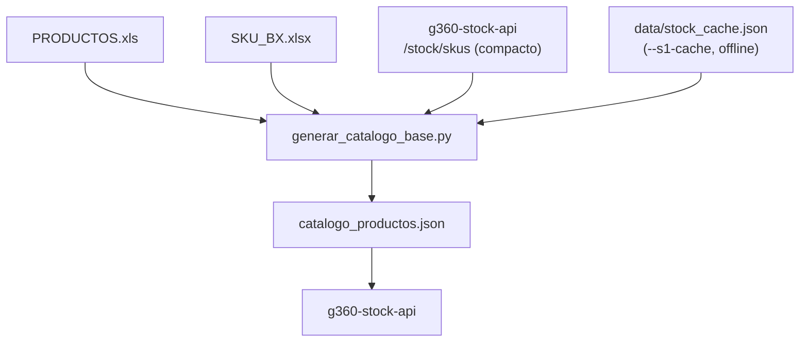

# G360 Master Data

> Sistema centralizado de datos maestros para proyectos G360.
> Genera JSON de catálogo completo desde ERP + SKU_BX + universo de stock.

[]()
[]()
[]()



> **El catálogo es el allowlist del API.** Todo SKU que puede aparecer en
> `/stock` y cotizarse tiene que estar publicado acá: si no está, el API lo
> muestra como `sin_catalogo` (sin precio, sin peso, sin caja).

---

## Estructura

```
g360-master-data/
├── data/                       ← MATERIA PRIMA LOCAL (exports manuales, NO se versiona)
│   ├── PRODUCTOS.xls           ← Maestro del ERP (mensual/bimestral)
│   │   Columnas: CODIGO, NOMBRE, COD_EAN, COD_EAN_14, CAN_KG_UM,
│   │              LINEA, GRUPO, TIPO, FAMILIA, FLG_INACTIVO,
│   │              FLG_DESCONTINUADO, PRECIO
│   │   Aporta: ficha, EAN, peso, línea, precio y vigencia
│   ├── SKU_BX.xlsx             ← Guía de venta (manual: se agrega al ingresar stock)
│   │   Columnas: ORDEN, SKU, UN_BX, ESTADO_LINEA
│   │             + LARGO_CM, ANCHO_CM, ALTO_CM, PESO_CAJA_KG
│   │             + M3_CAJA, M3_UNIDAD (calculadas, opcionales)
│   │   Aporta: qué se vende, unidades por caja, orden comercial y m³
│   ├── KARDEX_BASE.xlsx        ← Padrón de artículos por almacén (export manual, 179.591 filas)
│   │   Columnas: colId/colNom de Almacén, Línea, Grupo, Tipo, Familia,
│   │              Artículo y UM (sin cantidades ni fechas)
│   │   Aporta: taxonomía observada SKU × almacén (validar/derivar líneas).
│   │   Hoy NO lo consume el generador (fase 3: demanda/rotación)
│   └── plantilla_precios.xlsx  ← Plantilla comercial (DESCUENTOS/PRECIOS_FIJOS/SKU_CLIENTES)
│       Aporta: descuentos y precios fijos (vía scripts/leer_plantilla_precios.py)
│
├── plantillas/                 ← MOLDES versionados de los archivos manuales
│   ├── SKU_BX.xlsx             ← molde vacío (columnas de caja + fórmulas m³)
│   └── plantilla_precios.xlsx  ← molde vacío (DESC1..6 como fracción)
│
├── output/
│   └── catalogo_productos.json ← Catálogo generado (3.538 SKUs)
│
├── scripts/
│   ├── contratos.py            ← Contrato de encabezados: campos canónicos + alias
│   ├── validar_encabezados.py  ← Paso 0: valida las fuentes antes de generar
│   ├── generar_catalogo_base.py ← Genera catálogo desde ERP + SKU_BX + stock (principal, v3.7)
│   ├── generar_catalogo.py     ← Generador legacy v1 (no usar: no lee el ERP actual)
│   ├── crear_plantillas.py     ← Genera/migra las plantillas de plantillas/
│   ├── leer_plantilla_precios.py ← Lee plantilla_precios.xlsx (hojas DESCUENTOS/PRECIOS_FIJOS/SKU_CLIENTES)
│   ├── sanitize_key.py         ← Sanea API_KEY (quita whitespace invisible)
│   ├── simular_actualizacion.py ← Simula el ciclo de actualización de código (SKU nuevo)
│   ├── validar_taxonomia.py     ← Validación cruzada de taxonomía (master-data ↔ stock-api)
│   ├── ver_estado.py           ← Muestra estado del catálogo generado
│   └── tests/                   ← Tests unitarios (pytest)
│
├── actualizar_catalogo.bat     ← Workflow interactivo + modo automático (--auto)
└── README.md
```

`data/` es **la** carpeta de materia prima: cada archivo aporta una parte del
catálogo y se reemplaza completo cuando llega el export nuevo (no se edita a
mano ni se mezcla). **No se versiona**: son exports pesados y cambian seguido;
el repo solo lleva el catálogo generado (`output/`).

`plantillas/` es lo único que **sí** se versiona de los archivos manuales: son
moldes vacíos (con encabezados, fórmulas y listas desplegables) que se copian a
`data/` la primera vez y después viven ahí. El generador **nunca** lee de
`plantillas/`: lee de `data/`, igual que con los exports del ERP.

```bat
:: Crear/refrescar los moldes (no toca data/)
python scripts\crear_plantillas.py

:: Copiar a data/ solo lo que no exista todavia (no pisa nada)
python scripts\crear_plantillas.py --instalar

:: Agregar las columnas de caja a un data/SKU_BX.xlsx que ya tiene datos
python scripts\crear_plantillas.py --migrar
```

Hoy el generador consume **PRODUCTOS.xls + SKU_BX.xlsx + el universo de stock**;
`KARDEX_BASE.xlsx` y `plantilla_precios.xlsx` están para las siguientes fases
(rotación/demanda, descuentos, etc.). Cuando se sume una fuente nueva, se
agrega acá, se declara su contrato en `scripts/contratos.py` y se escribe su
lector en `scripts/`.

---

## Flujo de datos

```
1. Descargar PRODUCTOS.xls desde appweb.cipsa.com.pe (mensual/bimestral)
2. Actualizar SKU_BX.xlsx con nuevos SKUs (manual, cuando ingresa stock nuevo)
3. Ejecutar: actualizar_catalogo.bat → Opción 1 (o `actualizar_catalogo.bat --auto` para generar + subir sin preguntar)
4. Verificar output/catalogo_productos.json (opción 2 del bat)
5. Subir al API: Opción s en el bat (requiere `API_KEY` definida), o manualmente:
   curl -X POST "https://g360-stock-api.onrender.com/api/v1/catalog/upload" \
        -H "X-API-Key: %API_KEY%" \
        -F "archivo=@output/catalogo_productos.json"
```

> El `copy` a `..\g360-stock-api\data\catalog_cache.json` solo actualiza el entorno
> local de desarrollo. Producción (Render) **solo** se actualiza vía `POST /api/v1/catalog/upload`
> o vía auto-carga desde GitHub (`catalogo_raw_url`, TTL 6h).
> Definir la clave en la misma terminal antes de ejecutar:
> `set API_KEY=tu_clave` (cmd) o `$env:API_KEY="tu_clave"` (PowerShell).

### Contrato de encabezados (paso 0)

**Regla:** las fuentes se leen por **NOMBRE** de columna, nunca por posición.

Antes cada lector usaba índices fijos (`cell_value(r, 11)`, `row[2]`): si el
export agregaba una columna, el catálogo se generaba igual pero con el precio
en la familia y la línea en el peso. Sin error, sin aviso. Como el catálogo es
el allowlist del API, ese bug se propaga a todo lo que muestra.

El contrato vive en **`scripts/contratos.py`**: cada fuente declara campos
canónicos con sus alias, y los encabezados se comparan normalizados (sin
acentos, sin NBSP/BOM, sin espacios de más, en mayúsculas). Ejemplo:

| Fuente | Campo | Alias aceptados |
|--------|-------|-----------------|
| ERP | `sku` | `CODIGO`, `SKU` |
| ERP | `peso_kg` | `CAN_KG_UM` (sí: el ERP llama "peso" a esa columna), `PESO`, `PESO_KG` |
| ERP | `precio` | `PRECIO`, `PRECIO_LISTA` |
| SKU_BX | `orden` | `ORDEN`, `N`, `N°`, `NRO` |
| SKU_BX | `un_bx` | `UN_BX`, `U_BX`, `U/BOX`, `UNIDADES_POR_CAJA` |
| DESCUENTOS | `desc1` | `DESC1`, `DESC_ADIC01`, `DESC_ADIC1` |
| PRECIOS_FIJOS | `precio_fijo` | `PRECIO_FIJO`, `PRECIO_FINAL`, `PRECIO` |

**Severidad**

| Situación | Efecto |
|-----------|--------|
| Falta una columna **obligatoria** | `ErrorContrato` **fatal**: no se genera catálogo, el mensaje dice qué falta y qué se encontró |
| Columna de más, encabezado duplicado o alias ambiguo | **Aviso** (se usa la primera/prioritaria) |
| El contenido no coincide con el campo (ej. `PRECIO` sin números en el 90% de la muestra) | **Error** en el paso 0: detecta el corrimiento de columnas que el encabezado solo no ve |

El **paso 0 del BAT** es `scripts/validar_encabezados.py`, que valida las cinco
fuentes antes de generar:

```bat
python scripts\validar_encabezados.py
python scripts\validar_encabezados.py --s1-xls ruta\REPT_STOCK_xx_xx_xxxx.xls
python scripts\validar_encabezados.py --json
```

Un error en las fuentes que alimentan el catálogo (ERP, SKU_BX, S1) **frena
todo**. Un problema en las informativas (plantilla de precios, KARDEX,
revisión de guía) se reporta pero no bloquea la publicación. Dos avisos
merecen atención especial porque anticipan sorpresas:

- **ERP viejo**: el paso 0 informa hace cuántos días se exportó y avisa si
  pasa de 60 (el catálogo saldría "válido" pero rancio: altas que no entran,
  precios desactualizados).
- **Universo S1 parcial o sin taxonomía**: si el API devuelve un reporte
  cortado con HTTP 200, la cobertura da OK (se calcula contra ese mismo
  universo) y nadie lo nota. Por eso el generador compara contra la corrida
  anterior y publica `metadata.universo_stock.previo_skus/variacion`: una
  caída ≥ 15% sale como ALERTA en consola, queda registrada en el metadata
  y el validador la convierte en error (bloquea el upload). Si la caída es
  real (baja masiva), se revisa y se publica con
  `actualizar_catalogo.bat --upload`.
- **Universo sin taxonomía S1**: el generador cuenta cuántos SKUs vienen sin
  línea (`sin_taxonomia_s1`) y muestra la `fecha_descarga`/`cache_expirado`
  que reporta el API. Si ≥ 15% viene sin línea (parseo viejo o cache
  anterior en el API), ALERTA + error del validador: los S1 caen a OTROS y
  los D no se enlazan. Remedio: verificar deploy/refresh del API y
  regenerar (el BAT lo muestra todo).

> **SKU siempre es TEXTO.** `016763` y `16763` son artículos distintos: si la
> celda se guarda como número, los ceros a la izquierda se pierden y el SKU
> deja de coincidir con el ERP. El validador lo reporta como error.

**Revisión de guía (SKU_BX + precios vs ERP + KARDEX).** El paso 0 también
cruza cada SKU manual contra los maestros con coincidencia **exacta** (los
SKU no tienen "similares": o el código está o no está). Si no va a entrar
al catálogo, dice **por qué** — `inactivo` (en ERP pero dado de baja),
`proceso` (línea excluida), `kardex` (existe en KARDEX pero no en ERP:
revisar maestro) o `inexistente` (no está en ningún lado: mal escrito o
código que no existe). Es informativo (no bloquea): el generador ya omite
esos SKUs por regla.

Los SKUs ya revisados se silencian en `config/guia_ignorados.json`
(`{"ignorados": {"04058": "baja definitiva"}}`): la próxima corrida ya no
los muestra. Si el SKU se corrige o se elimina de la guía, la entrada sobra
y se puede borrar. El generador respeta la misma lista en su WARN final.

**Reporte S1 (sin encabezado real).** El `.xls` del S1 trae 9–12 filas de
preámbulo y una fila de encabezados con celdas combinadas: `ARTICULO` queda en
la columna de la descripción y el **SKU en la columna anterior**. Por eso no se
busca por nombre: se ubica la fila por **anclas**
(`ARTICULO`/`ALMACEN`/`UM`/`STOCK`/`PREDESPACHO`) y se verifica el SKU contra
los datos, con fallback por contenido. Lo implementan los dos lados:

- `scripts/contratos.py` → `detectar_columnas_s1` (validador, falla con mensaje);
- `g360-stock-api/app/core/parsers.py` → `detectar_columnas` (servicio: si no
  encuentra las anclas, cae al layout histórico y deja un `warning`).

### El universo de stock (no es opcional)

El catálogo no sale solo del ERP + SKU_BX: incluye además los SKUs que **tienen
stock físico o compromiso de venta** (hay despacho que hacer y sin catálogo no
se conocen peso, EAN ni caja). Ese universo se consulta en el mismo API de stock
que recibe el catálogo, en el endpoint **compacto** `GET /api/v1/stock/skus`
(consolidado por SKU, sin el desglose por almacén que multiplica el payload).

Si el universo no entra, el catálogo sale **incompleto y en silencio**: en una
corrida sin universo se perdieron **212 SKUs** que sí tenían stock. Para que no
vuelva a pasar, el generador publica la cobertura en el `metadata` y avisa con
`ALERTA` si algún SKU con movimiento quedó fuera.

| Variable | Default | Para qué |
|----------|---------|----------|
| `API_KEY` | — | Clave del API. Se usa para el upload **y** para leer el universo (el API acepta la misma clave para ambas cosas) |
| `API_URL` | `https://g360-stock-api.onrender.com` | URL del API |
| `G360_STOCK_URL` | = `API_URL` | URL para leer el universo de stock |
| `G360_STOCK_API_KEY` | = `API_KEY` | Clave de lectura del universo |
| `G360_S1_CACHE` | — | JSON del reporte S1 (ej. `g360-stock-api/data/stock_cache.json`). Si está, **no consulta el API** |

El BAT define `G360_STOCK_URL` y `G360_STOCK_API_KEY` a partir de `API_KEY`, y
**pide la clave antes de generar** (en modo interactivo). En modo `--auto` sin
`API_KEY` aborta: no deja generar un catálogo a medias. La excepción es
`G360_S1_CACHE`: con el JSON del S1 no hace falta clave ni red para generar
(el upload al API sí la sigue necesitando).

Después de generar, el BAT **valida** el catálogo (`validar_taxonomia.py`) y
**no sube nada** si hay incoherencias: un catálogo con líneas mixtas, taxonomía
divergente del API o cobertura incompleta no llega a producción.

```bash
# Con el API en vivo (default)
python scripts/generar_catalogo_base.py

# Offline: usa el JSON del reporte S1 copiado al repo (sin clave ni red)
python scripts/generar_catalogo_base.py --s1-cache ..\g360-stock-api\data\stock_cache.json

# Sin universo (a propósito: catálogo incompleto, solo para depurar)
python scripts/generar_catalogo_base.py --sin-universo-stock
```

---

## Regla de inclusión (v3.6.0)

Un SKU entra al catálogo si cumple **cualquiera** de estas condiciones:

```
en guía (SKU_BX) ∨ stock > 0 ∨ compromiso > 0 ∨ (vigente ∧ precio > 0)
```

| Filtro | Resultado |
|--------|-----------|
| Inactivos (FLG_INACTIVO) | Excluidos (siempre: el ERP los borra) |
| Líneas de proceso (códigos `70`/`71`) | Excluidas (siempre) |
| `sin_precio_ni_movimiento` | Excluido: ni stock, ni compromiso, ni guía, ni precio |
| `descontinuado_sin_guia_ni_stock` | Excluido: descontinuado y sin nada que despachar |
| Descontinuado en guía o con stock | **Incluido** con `descontinuado: true`, `vigente: false` |
| SKU con stock/compromiso y **sin precio** | **Incluido** con `cotizable: false`, `por_activar: true` |
| SKUs duplicados en ERP | Solo el primero |
| SKUs en guía sin ERP | Advertencia y se omiten (ej. `04058`) |
| **Productos finales** | **3.538 SKUs** |

El precio ya **no decide la presencia**: decide la **cotizabilidad**. Un SKU sin
precio puede estar publicado (hay producto físico), pero se marca `por_activar`
para que comercial lo complete. `cotizable` y `por_activar` son complementarios
exactos (`cotizable = precio > 0`).

### Categorías de venta (el semáforo)

La categoría de negocio sigue saliendo de la línea (con la marca mandando en
Crayola), pero para venta se publica además `categoria_venta`:

| `categoria_venta` | Significado |
|-------------------|-------------|
| `VINIBALL` | Se vende |
| `VINIFAN` | Se vende |
| `REPRESENTADAS` | Se vende (incluye todas las líneas Crayola `CA..CG`) |
| `REVISION_VENTA` | Está en el catálogo (hay producto), pero **no se cotiza** hasta que comercial revise |

`REVISION_VENTA` agrupa MATERIALES, INDUSTRIAL, CIPTECH, PUBLICIDAD,
DESCARTE Y VARIOS, OTROS, etc. La distribución actual: **REVISION_VENTA 1.152 /
VINIFAN 972 / REPRESENTADAS 838 / VINIBALL 576**.

### Derivados `D` (método D)

Los SKU que terminan en `D` son un producto **secundario, solo similar** a su
base (otra presentación/contenido, típicamente línea 98). Se **enlazan** como
referencia (`derivado_de`), pero **cada SKU conserva su propia ficha**: no se
fusiona el stock ni se hereda precio, peso, EAN, línea o categoría de la base
(heredar el precio pondría en vitrina un precio que no es el del producto).
Sin precio propio el `D` queda `por_activar` hasta activarse con su precio real.

Condiciones para enlazar (todas):

1. el SKU termina en `D`;
2. la línea es `98` (sin embalaje) o la línea comercial de la base;
3. existe la base sin la `D` (en catálogo o en el ERP);
4. similitud de nombre ≥ `0,80` (SequenceMatcher sobre texto normalizado).

Si la base no está publicada, el derivado entra igual con su propia ficha y el
validador lo reporta como **aviso** (hay que revisar por qué la base no entra).

### Trazabilidad

El `metadata` del JSON registra por qué se quedó fuera cada fila del ERP, si el
universo de stock entró y si hubo SKUs con movimiento que no se publicaron:

```json
"regla_inclusion": "en guia ∨ stock > 0 ∨ compromiso > 0 ∨ (vigente ∧ precio > 0)",
"exclusiones": {
  "linea_proceso": 6538,
  "sin_precio_ni_movimiento": 2236,
  "descontinuado_sin_guia_ni_stock": 446
},
"universo_stock": { "incluido": true, "skus": 2214, "con_stock": 2204, "con_compromiso": 666, "error": "" },
"universo_skus": ["016763", "..."],
"cobertura_faltante": []
```

`cobertura_faltante` es el invariante: **debe ser `[]`**. Si trae un SKU, ese
producto tiene movimiento y quedó fuera del catálogo (el generador imprime
`ALERTA` y el validador falla). `universo_skus` son los SKUs vendibles del
reporte (excluye líneas de proceso) para que el validador lo verifique sin
releer el S1.

El generador además avisa en consola cuando el catálogo **se achica** respecto
del anterior (suele ser una fuente faltante, no menos productos).

---

## Datos generados

| Campo | Fuente | Notas |
|-------|--------|-------|
| sku, nombre | PRODUCTOS.xls / S1 | | |
| ean13 | PRODUCTOS.xls | ~36% tiene valor |
| ean14 | PRODUCTOS.xls | ~29% tiene valor |
| peso_kg | PRODUCTOS.xls | |
| linea, grupo, tipo, familia | PRODUCTOS.xls / S1 | `linea` es el **código canónico** (2 chars); el nombre va en `linea_nombre`. Grupo/tipo/familia salen **sin** el código del S1 (`03 - BORRADOR` → `BORRADOR`) |
| um | S1 | Unidad de medida del reporte |
| linea_codigo | Mapa estático + desambiguación por grupo | SKUs Crayola (`C*`) usan su prefijo como línea propia (CA/CB/CC/CD/CE/CF/CG → REPRESENTADAS); líneas ERP genéricas (72/76/77/79) quedan 100% VINIFAN. Grupo desempata cuando el nombre es ambiguo (`ACCESORIOS|PINCELES`→`CD`) |
| categoria | Marca > línea | La **marca manda**: todo SKU `C*` es `REPRESENTADAS` con línea propia (su prefijo de 2 letras), aunque la línea del ERP sea genérica o la sub-marca aún no exista en la taxonomía. Para el resto, la categoría sale de la línea |
| categoria_venta | Derivada de `categoria` | `VINIBALL` / `VINIFAN` / `REPRESENTADAS`, o `REVISION_VENTA` para el resto |
| un_bx | SKU_BX.xlsx | 29% tiene valor definido (1 por default) |
| orden | SKU_BX.xlsx (col A) | Índice maestro — orden ascendente |
| estado_linea | SKU_BX.xlsx (col D) | NACIONAL, IMPORTADO, NUEVO, TRADICIONAL |
| precio | PRODUCTOS.xls | |
| descontinuado | PRODUCTOS.xls (FLG_DESCONTINUADO) + SKU_BX + stock | `true` si está descontinuado y entra al catálogo; el API lo propaga como badge |
| en_guia | SKU_BX.xlsx | `true` si el SKU está curado en la guía |
| compromiso | S1 (`predespacho`) | `true` si tenía compromiso de venta al generar |
| cotizable / por_activar | `precio > 0` | Complementarios exactos |
| vigente | ERP | `false` si el ERP lo marca descontinuado |
| derivado_de | Método D | SKU base cuando es un derivado de línea 98 |
| origen | ERP / S1 | `erp` (ficha del maestro) o `s1` (solo existe en el reporte) |
| stock_snapshot / predespacho_snapshot | S1 | Foto del movimiento al generar (trazabilidad, no stock vivo) |
| nombre_corto | Generado con regex | Elimina prefijos, marcas |
| keywords | Generado automáticamente | Palabras clave del nombre + categoría |

> La taxonomía es **compartida** con `g360-stock-api` (`app/core/constants.py`).
> Ambos repos se validan cruzadamente con `scripts/validar_taxonomia.py`: si
> divergen, /stock y /catalog clasifican el mismo SKU en categorías distintas.

---

## Scripts

### `contratos.py`

Núcleo de la convención (ver *Contrato de encabezados*): normalización de
encabezados y valores, `ErrorContrato`, `resolver_columnas` (campo canónico →
índice), los contratos por fuente (`CONTRATO_ERP`, `CONTRATO_SKU_BX`,
`CONTRATO_KARDEX`, `CONTRATO_PLANTILLA_*`), las anclas del S1
(`detectar_columnas_s1`), la lista de almacenes publicados, `calcular_m3` y
`huella_fuente` (sha256 + fecha para la trazabilidad). No lee archivos por sí
mismo: lo usan todos los lectores.

### `validar_encabezados.py`

Paso 0 del workflow. Valida ERP, SKU_BX, plantilla de precios, S1 (si hay un
`.xls` en `data/`) y KARDEX: columnas obligatorias por nombre, **sanidad del
contenido** (un SKU parece SKU, un precio es número, UN_BX entero, descuentos
en rango), duplicados, columnas de más, SKUs guardados como número y cajas
incompletas.

```bash
python scripts/validar_encabezados.py
python scripts/validar_encabezados.py --s1-xls ..\g360-erp-stock-consolidator\samples\REPT_STOCK_22_05_2026.xls
python scripts/validar_encabezados.py --json
```

Sale con código 1 solo si falla una fuente que alimenta el catálogo.

### `generar_catalogo_base.py`

Genera el catálogo completo desde las tres fuentes.

```bash
# Uso básico (API en vivo, requiere G360_STOCK_API_KEY o API_KEY)
python scripts/generar_catalogo_base.py

# Con argumentos
python scripts/generar_catalogo_base.py -i data/PRODUCTOS.xls -u data/SKU_BX.xlsx -o output/catalogo_productos.json

# Offline: universo desde el JSON del reporte S1 copiado al repo
python scripts/generar_catalogo_base.py --s1-cache ..\g360-stock-api\data\stock_cache.json

# Solo validación (no genera output)
python scripts/generar_catalogo_base.py --validate-only

# Sin universo de stock (genera un catálogo incompleto, a propósito)
python scripts/generar_catalogo_base.py --sin-universo-stock
```

| Argumento | Env equivalente | Para qué |
|-----------|-----------------|----------|
| `--erp` / `-e` | — | `PRODUCTOS.xls` |
| `--unbx` / `-u` | — | `SKU_BX.xlsx` |
| `--output` / `-o` | — | JSON de salida |
| `--stock-url` | `G360_STOCK_URL` | API para leer el universo (`/stock/skus`) |
| `--stock-key` | `G360_STOCK_API_KEY` | Clave de lectura |
| `--s1-cache` | `G360_S1_CACHE` | JSON local del S1: no consulta el API |
| `--sin-universo-stock` | — | Genera solo con ERP + guía (incompleto) |
| `--validate-only` / `-v` | — | Valida sin escribir |

### `actualizar_catalogo.bat`

Workflow interactivo + modo automático:

```
0) Validar encabezados de las fuentes (contrato)
1) Generar catalogo base (PRODUCTOS.xls + SKU_BX + universo de stock)
2) Ver estado del catalogo
0) Salir
```

> El paso 0 corre **siempre**, antes de generar. Si una fuente cambió de
> formato, el BAT corta ahí con el mensaje del contrato: no hay forma de
> generar un catálogo con las columnas corridas.

```bat
:: Interactivo (menu)
actualizar_catalogo.bat

:: Automatico: genera + sube al API sin preguntar (requiere API_KEY)
actualizar_catalogo.bat --auto

:: Automatico local: genera + copia local, sin subir
actualizar_catalogo.bat --auto-local

:: Offline: universo desde el JSON del S1 (no consulta el API)
set G360_S1_CACHE=..\g360-stock-api\data\stock_cache.json
actualizar_catalogo.bat --auto-local

:: Subir JSON existente sin regenerar (requiere API_KEY)
actualizar_catalogo.bat --upload
```

Con `G360_S1_CACHE` definido, el BAT **no pide clave para generar** (el upload
sigue necesitándola). Es el modo recomendado cuando el reporte S1 se copia al
repo a mano, sin depender de que el API esté arriba.

El upload reintenta 3 veces (cold start de Render free-tier) y requiere
`X-API-Key` (variable `API_KEY` en la terminal). En modo interactivo, si
falta la clave el BAT la pide por pantalla; los valores degenerados
(<4 caracteres) se rechazan al instante sin consumir reintentos.

Para persistirla (una sola vez, `cmd` — ojo: `setx` va SIN `=`):
```bat
set API_KEY=tu_clave
setx API_KEY tu_clave
```

### Plantillas manuales (`crear_plantillas.py`)

Los archivos que se llenan a mano (`SKU_BX.xlsx`, `plantilla_precios.xlsx`)
tienen un molde versionado en `plantillas/`. El molde trae lo que un Excel a
mano no garantiza:

- **SKU como TEXTO** (no se comen los ceros a la izquierda);
- `ESTADO_LINEA` con lista desplegable;
- **m³ calculado** con fórmulas (`M3_CAJA = largo*ancho*alto/1.000.000`,
  `M3_UNIDAD = M3_CAJA/UN_BX`);
- descuentos como **fracción** validada (0 ≤ x < 1: `10% = 0.10`);
- una hoja `LEEME` con las reglas de cada columna.

```bash
# Crear/refrescar los moldes (plantillas/)
python scripts/crear_plantillas.py

# Instalar en data/ solo si el archivo no existe (nunca pisa datos)
python scripts/crear_plantillas.py --instalar

# Migrar un data/SKU_BX.xlsx que ya tiene datos: agrega las columnas de caja
# al final y las fórmulas en las filas existentes (hace backup .bak.xlsx)
python scripts/crear_plantillas.py --migrar
```

Flujo: se copia el molde a `data/`, se llena ahí y se sigue editando ahí. El
generador lee **siempre** de `data/`.

### `leer_plantilla_precios.py`

Lee `plantilla_precios.xlsx` y genera `precios_productos.json`.

```bash
python scripts/leer_plantilla_precios.py -i data/plantilla_precios.xlsx
python scripts/leer_plantilla_precios.py -i ... --sku-bx data/SKU_BX.xlsx
python scripts/leer_plantilla_precios.py -i ... --catalogo output/catalogo_productos.json
```

v2.0: lee por nombre de columna (acepta `DESC1..6` y `DESC_ADIC01..06`), la
hoja `PRODUCTOS` dejó de ser obligatoria (el orden vive en `SKU_BX`), y los
descuentos se publican como fracción. Con `--catalogo` filtra a los SKUs
publicados; con `--sku-bx` copia el orden maestro.

### `validar_taxonomia.py`

Validación cruzada: taxonomía del catálogo, líneas Crayola, líneas mixtas,
líneas sin código, **coherencia de precio y flags** (`cotizable`/`por_activar`/
`compromiso`/`categoria_venta`/`derivado_de`), **cobertura del universo**
(`cobertura_faltante` vacío + cross-check de `universo_skus`) y **divergencia
con `g360-stock-api`**.

```bash
python scripts/validar_taxonomia.py
python scripts/validar_taxonomia.py --catalogo output/catalogo_productos.json
```

Devuelve **errores** (bloquean la subida al API) y **avisos** (mantenimiento
pendiente, no bloquean). El BAT la ejecuta después de generar: si hay errores,
**no sube el catálogo**.

> Un catálogo generado sin universo de stock es un **error**, no un aviso:
> pierde los SKUs con despacho que no están en SKU_BX (212 en la última
> corrida). Si el API de stock no responde, reintenta 3 veces y, si sigue
> caído, regenera antes de subir.

### Sub-marca Crayola nueva

Si aparece una sub-marca nueva (CH, CI…), el generador:

1. la **publica ya clasificada** como `REPRESENTADAS` en la taxonomía del
   metadata (así ningún consumidor la deja en el default `OTROS`);
2. avisa en consola y el validador lo reporta como aviso (no bloquea).

Para dejarla fija hay que tocar **dos** archivos:

```python
# scripts/generar_catalogo_base.py
CATEGORIA_POR_LINEA = { ..., "CH": "REPRESENTADAS" }

# g360-stock-api/app/core/constants.py
CATEGORIAS = { ..., "REPRESENTADAS": ["85", "CE", "CF", "CA", "CB", "CC", "CD", "CG", "CH"] }
```

Mientras no se fije, el API de stock sigue clasificando bien los C* por marca
(todo C* es REPRESENTADAS, incluso sin catálogo).

### `simular_actualizacion.py`

Simula el ciclo de actualización de código (SKU nuevo) de punta a punta:
arma un reporte ERP simulado (.xls) y una guía SKU_BX simulada (.xlsx), corre
el generador real y verifica los resultados. Con `--api-url`/`--api-key`
sube el catálogo simulado a un API de stock y comprueba que el SKU nuevo quede
disponible en `/stock`.

```bash
python scripts/simular_actualizacion.py
python scripts/simular_actualizacion.py --api-url http://127.0.0.1:8099 --api-key CLAVE
```

### Tests

```bash
python -m pytest scripts/tests -q
```

145 tests: generación (inclusión, taxonomía, método D, cobertura, universo
S1), contrato de encabezados (normalización, alias, duplicados, columnas
corridas, anclas del S1, cajas/m³) y robustez de la validación.

---

## Output JSON

```json
{
  "metadata": {
    "version": "3.7.0",
    "generated_at": "2026-10-22T10:30:46.334309",
    "source_erp": "PRODUCTOS.xls",
    "source_un_bx": "SKU_BX.xlsx",
    "source_stock": "http://appweb.cipsa.com.pe:8054/...",
    "fuentes": [
      { "archivo": "PRODUCTOS.xls", "bytes": 4844312, "sha256": "2dbbbf8b9669cc52", "modificado": "2026-10-20T16:16:53" },
      { "archivo": "SKU_BX.xlsx", "bytes": 37266, "sha256": "e910d11c282f85b0", "modificado": "2026-09-21T23:37:32" }
    ],
    "total_productos": 3538,
    "estadisticas": {
      "sin_ean13": 2267,
      "con_ean14": 1037,
      "sin_unbx": 2516,
      "con_unbx": 1022,
      "con_caja": 0,
      "descontinuados": 348,
      "sin_linea_codigo": 0,
      "en_guia": 1022,
      "con_compromiso": 667,
      "por_activar": 768,
      "cotizables": 2770,
      "derivados": 30,
      "solo_s1": 522,
      "por_categoria_venta": {
        "REVISION_VENTA": 1152,
        "VINIFAN": 972,
        "REPRESENTADAS": 838,
        "VINIBALL": 576
      },
      "por_categoria": { "VINIFAN": 972, "REPRESENTADAS": 838, "VINIBALL": 576, "...": "..." },
      "por_linea": { "85": 776, "01": 523, "78": 421, "80": 303, "...": "..." },
      "por_estado_linea": { "NUEVO": 406, "IMPORTADO": 285, "TRADICIONAL": 191, "NACIONAL": 140 }
    },
    "categorias_por_linea": { "01": "VINIBALL", "78": "VINIFAN", "CA": "REPRESENTADAS", "...": "..." },
    "categorias_venta": ["VINIBALL", "VINIFAN", "REPRESENTADAS"],
    "categoria_venta_revision": "REVISION_VENTA",
    "regla_inclusion": "en guia ∨ stock > 0 ∨ compromiso > 0 ∨ (vigente ∧ precio > 0)",
    "lineas_nombre_a_codigo": { "PELOTAS": "01", "ARCHIVO": "78", "MANUALIDADES": "CE", "...": "..." },
    "lineas_grupo_a_codigo": { "ACCESORIOS|PINCELES": "CD" },
    "exclusiones": {
      "linea_proceso": 6538,
      "sin_precio_ni_movimiento": 2236,
      "descontinuado_sin_guia_ni_stock": 446
    },
    "universo_stock": { "incluido": true, "skus": 2214, "con_stock": 2204, "con_compromiso": 666, "error": "" },
    "universo_skus": ["016763", "..."],
    "cobertura_faltante": []
  },
  "productos": [
    {
      "sku": "016763",
      "nombre": "FUTBOL PU FUTURE #5",
      "nombre_corto": "Futbol Future #5",
      "ean13": "",
      "ean14": "",
      "categoria": "VINIBALL",
      "categoria_venta": "VINIBALL",
      "linea": "01",
      "linea_nombre": "PELOTAS",
      "grupo": "IMPORTADA VINIBALL",
      "tipo": "PU",
      "familia": "FUTBOL",
      "um": "",
      "un_bx": 18,
      "orden": 1,
      "estado_linea": "IMPORTADO",
      "peso_kg": 0.4,
      "dimensiones_caja": {
        "largo_cm": 40,
        "ancho_cm": 30,
        "alto_cm": 25,
        "m3_caja": 0.03,
        "m3_unidad": 0.001667,
        "peso_caja_kg": null
      },
      "precio": 70.0,
      "descontinuado": false,
      "linea_codigo": "01",
      "en_guia": true,
      "compromiso": true,
      "cotizable": true,
      "vigente": true,
      "por_activar": false,
      "derivado_de": "",
      "origen": "erp",
      "stock_snapshot": 615,
      "predespacho_snapshot": 181,
      "keywords": ["01", "FUTBOL", "FUTURE", "PELOTAS", "VINIBALL"]
    }
  ]
}
```

`dimensiones_caja` es el tamaño **físico** de la caja (largo/ancho/alto en cm,
m³ de la caja y m³ por unidad); `un_bx` es **cuántas unidades entran**. Van en
campos separados a propósito: el API ya usa `caja` para las unidades. Si falta
largo, ancho o alto, `dimensiones_caja` es `null`: no se inventa volumen.
`m3_caja` se **calcula en el generador** (no se confía en la fórmula de Excel:
una celda pegada como valor no se recalcula nunca).

`metadata.fuentes` deja la huella (sha256 corto, tamaño y fecha) de los
archivos que se leyeron: el catálogo es trazable aunque el archivo se
reemplace después.

---

## Integración con API

El endpoint `/api/v1/catalog/upload` recibe el JSON y lo cachea en memoria (TTL 6h).
Las operaciones de catálogo requieren el header administrativo `X-API-Key`.
Los items de stock siempre se sirven enriquecidos y requieren la clave de lectura
`X-API-Key` configurada para el cliente.

```bash
# Verificar estado del catálogo cargado
curl -H "X-API-Key: $API_KEY" \
     "https://g360-stock-api.onrender.com/api/v1/catalog/health"

# Subir catálogo
curl -X POST "https://g360-stock-api.onrender.com/api/v1/catalog/upload" \
     -H "X-API-Key: $API_KEY" \
     -F "archivo=@output/catalogo_productos.json"

# Universo compacto (lo que consume el generador)
curl -H "X-API-Key: $API_KEY" \
     "https://g360-stock-api.onrender.com/api/v1/stock/skus?solo_con_movimiento=true"
```

`GET /api/v1/stock/skus` devuelve por SKU: descripción, línea, grupo, tipo,
familia, UM, categoría, `categoria_venta`, stock/predespacho/disponible
consolidados y `sin_catalogo`. No repite el SKU por almacén.

### Flags que el API propaga

`/stock` y `/catalog` exponen los mismos flags que publica el catálogo:
`categoria_venta`, `en_guia`, `compromiso`, `cotizable`, `por_activar`,
`vigente`, `origen`, `derivado_de`. Además el API calcula un badge único,
`revision`, con esta prioridad:

`sin_catalogo` → `por_activar` → `revision_venta` → `descontinuado` →
`compromiso` → `""` (disponible).

> `catalog_raw_url` apunta al raw de GitHub de este repo: un `push` a `main`
> actualiza producción solo (tras el TTL de 6 h). El `POST` es inmediato.

---

## Dependency

```
python>=3.11
openpyxl>=3.1.0
xlrd>=2.0.0
requests>=2.31.0      # lectura del universo de stock
pytest>=8.0.0         # tests
xlwt>=1.3.0           # solo para simular_actualizacion.py (reportes .xls)
```

---

## Familia G360

- **[g360-cli](https://github.com/carloscus/g360-cli)**: Bootstrap de proyectos
- **[g360-stock-api](../g360-stock-api/)**: API de stock con cache y enrich
- **[g360-stock-reporter-lit](../g360-stock-reporter-lit/)**: Frontend PWA

---
**Marca**: G360 · **Autor**: Carlos Cusi
